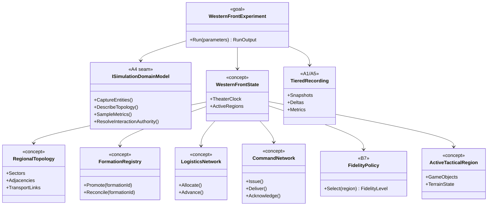
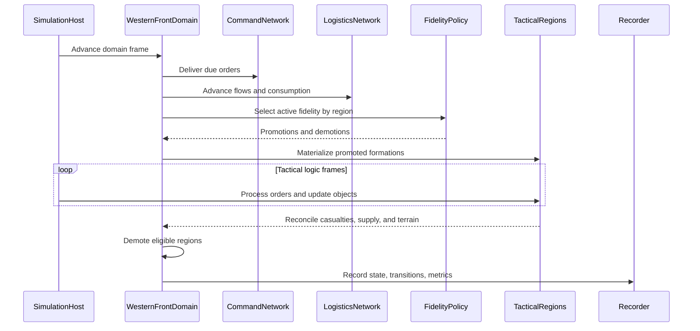

# Deep Dive: Western Front-Scale Simulation Goal

> Expands the First World War Western Front-scale simulation goal in the
> [Large-Scale RTS Roadmap](../README.md).
>
> Audience: human experiment charter for a long-term integration goal. Code references are in the
> agent-context appendix.

Purpose: define how to investigate a theater-scale Western Front simulation without prematurely
fixing its geography, force count, time resolution, combat model, or performance target. This
document is a charter and dependency map, not an implementation phase or task-card source. The
decision gates are settled, and the staged demonstrations are now phases of
[Track W](../track-w-western-front.md).

---

## 1. Goal and evidence sought

The goal is a spatially explicit simulation in which geography, formations, logistics, command,
combat, and uncertainty interact across multiple scales. The research question is whether
Panopticon's domain, recording, map, fidelity, and partition seams can support that experiment while
keeping cost and approximation error measurable.

Runs are offline, and detail outranks speed (see the detail-first stance Decision in
[open-questions.md](../open-questions.md)): the target is an all-tactical run with one entity per
soldier, not a real-time game. The first evidence must show that the same scenario can move
between aggregate and detailed representations while preserving declared quantities and producing
inspectable run output.

The goal remains directional. These values are parameters until experiments justify commitments:

- geographic extent and map projection;
- represented dates and campaign duration;
- historical or synthetic order of battle;
- smallest persistent formation and smallest active entity;
- campaign, operational, and tactical time steps;
- combat, casualty, morale, and entrenchment models;
- player control versus autonomous command;
- wall-clock and interactive-rate targets;
- acceptable approximation error.

## 2. Simulation layers

The simulation uses four representations rather than one uniform entity scale.

### 2.1 Theater layer

The theater layer owns:

- front sectors and strategic objectives;
- rail, road, river, and depot networks;
- production, replacements, and theater stockpiles;
- weather and campaign time;
- high-level intelligence state.

It advances the whole represented area without instantiating tactical entities everywhere.

### 2.2 Operational layer

The operational layer owns persistent formations and movement:

- brigade, division, corps, and army hierarchy;
- formation footprint, strength, cohesion, fatigue, and entrenchment;
- ammunition, food, fuel where applicable, and replacement state;
- route assignment, reserves, artillery allocation, and reconnaissance;
- issued orders, delivery delay, acknowledgement, and stale information.

The exact lowest persistent echelon is a decision gate. Formation identity must survive
aggregation, tactical activation, sharding, save/load, and replay.

### 2.3 Tactical layer

The tactical layer activates only for bounded regions that require detailed resolution. It may
contain:

- one `GameObject` per soldier, grouped into squads and sections through A4-3;
- machine-gun and artillery positions;
- engineers, vehicles, aircraft, and observation assets;
- trenches, wire, craters, structures, and local terrain;
- projectile, visibility, movement, and destruction state.

Track P gameplay remains the reference implementation of detailed RTS behavior. A Western Front
experiment may replace or extend its content and rules through Tracks A and D, but it does not
create a second engine.

### 2.4 Aggregate layer

Inactive formations use statistical state and flow models. They are not hidden collections of
fully simulated `GameObject` instances.

Promotion expands an aggregate into operational or tactical state. Demotion reduces detailed
state back into an aggregate. Both directions preserve explicitly named quantities:

- personnel and equipment;
- location and occupied area;
- supply and consumption state;
- cohesion, fatigue, morale, and entrenchment;
- command relationships and pending orders;
- casualties and uncertainty.

Conservation is exact where the quantity is discrete and intentionally bounded where the model is
statistical.

## 3. Domain model

A future Western Front adapter extends the shared `GameObject`/module runtime through
`ISimulationDomainModel`. It supplies domain projections and topology rather than replacing host,
recording, order, or persistence infrastructure.

The current `DomainEntitySummary` has only two generic scalar slots. That is insufficient to
reconstruct personnel, equipment, supply, cohesion, and command state across three layers. WF-0
therefore begins with an A1/A4 change request for a versioned, multi-valued domain snapshot
projection. Sampled metric series remain analysis output and do not substitute for reconstructable
state.

Conceptual state:

```text
WesternFrontState
  TheaterClock
  RegionalTopology
  FormationRegistry
  LogisticsNetwork
  CommandNetwork
  ActiveTacticalRegions
  WeatherState
  IntelligenceState

Formation
  StableFormationId
  ParentFormationId
  Echelon
  Composition
  Footprint
  Strength
  Supply
  Cohesion
  Fatigue
  Morale
  Entrenchment
  FidelityLevel

FormationOrder
  Issuer
  Recipient
  IssuedAt
  ExpectedArrival
  Priority
  ValidityWindow
  Objective
  Acknowledgement
```

Stable formation IDs are distinct from transient tactical object IDs. A promoted formation owns a
mapping to its active objects; it does not lose its operational identity.

## 4. Geography and topology

[B4b](b4b-geospatial-map-generation.md) supplies bounded real-world terrain. The simulation adds a
hierarchical topology over that map:

1. Theater and front sectors for strategic ownership and objectives.
2. Operational regions for formations, supply, and distributed ownership.
3. Road, rail, river, and depot graphs for movement and logistics.
4. Tactical cells/chunks for active detailed simulation.

The hierarchy must map every region and network edge to stable keys exposed through the domain
model. B6 partitions those keys; A5 uses them for recording and visualization.

Geospatial fidelity is independent from simulation fidelity. A high-resolution DEM does not
require every unit to be tactical, and an aggregate campaign can use the same map package as a
detailed local engagement.

B4b projects each import onto one Transverse Mercator grid with a custom central meridian, so a
single import can span UTM zones 31 and 32 within its scale-error limit. WF-3 still uses one
bounded sector.

## 5. Time and activation

The current simulation host advances one logic-frame clock. The first experiment determines
whether campaign and operational updates can be scheduled as coarse periodic systems over that
clock or require a domain-owned multi-rate scheduler.

The intended behavior is:

- campaign systems update at the coarsest cadence;
- operational movement, supply, and order transit update more frequently;
- active tactical regions run ordinary logic frames;
- inactive regions advance through aggregate transitions;
- promotion and demotion occur only at explicit synchronization points.

Activation policy is an experiment input. Candidate triggers include contact, observation,
operator interest, proximity to an objective, or measured uncertainty. Hysteresis prevents a
region from oscillating between fidelity levels.

Clock conversion, activation, and reconciliation events are recorded at operational level.
Tactical detail is recovered by seeded re-simulation from engine checkpoints, verified against
recorded operational hashes ([A1-6](a1-6-operational-recording.md)).

## 6. Command and information

The existing general/commander/soldier hierarchy is a useful local pattern, not a complete
theater command model. The experiment adds echelons above the A4-3 soldier groupings while retaining order-based
actuation.

Orders carry:

- issuer and recipient formation IDs;
- issue, expected-delivery, acknowledgement, and expiry times;
- objective, priority, and permitted initiative;
- the information snapshot on which the order was based.

Command behavior must model limited capacity, delay, disruption, and stale knowledge. Policies
read the information available to their echelon, not omniscient world state. Whether policies are
rule-based, optimized, or learned remains replaceable behind the Track A AI seams.

Orders eventually become engine `Order` values only at the active tactical boundary. Higher-level
orders remain domain data and cannot mutate tactical game state directly.

## 7. Logistics

Logistics is a conserved network flow, not periodic unit spawning.

The initial model includes:

- source pools and depots;
- rail, road, and optional river links with capacity and travel time;
- formation demand and local stockpiles;
- ammunition and replacements first, with other commodities added only when an experiment needs
  them;
- interdiction, link damage, and repair;
- allocation priorities and unmet-demand metrics.

Operational formations consume supply continuously or per event. Tactical activation initializes
local ammunition and replacement state from the parent formation. Reconciliation returns unused
stock and recorded consumption to the operational layer.

The logistics graph may cross spatial shard boundaries. Edge ownership and conservation rules
must be defined before distributed execution.

## 8. Combat and terrain

The charter does not select a casualty model. It requires two replaceable resolution families:

- aggregate combat for inactive operational regions;
- detailed Track P/F combat for active tactical regions.

Both consume compatible inputs and emit compatible outputs: casualties, equipment loss, supply
use, cohesion/morale change, displacement, terrain change, and uncertainty.

Track F supplies deformation, obstruction, physics, destruction, persistence, and authoring
capabilities. Tactical regions may create trenches, craters, destroyed structures, and blocked
routes. Aggregate regions retain summarized terrain effects that can be materialized if promoted.

No aggregate result may create or destroy strength silently. Promotion/demotion and combat
resolution produce conservation reports.

## 9. Dependency and evidence matrix

| Need | Roadmap dependency | Evidence required before implementation |
|---|---|---|
| Playable detailed combat loop | Track P | One complete reference battle can run, terminate, and report outcomes. |
| Headless runs and recording | A1-A3, A1-6, A5 | Long runs record operational state and checkpoints; tactical frames reconstruct with verified hashes; replay stays bounded-memory. |
| Domain projections and topology | A4-1 | A non-default domain reports entities, topology, metrics, and interaction authority. |
| Reconstructable multi-layer state | A1/A4 follow-up | A versioned snapshot projection carries formation, logistics, command, and layer state beyond `DomainEntitySummary`'s two scalar slots. |
| Hierarchical decisions | A4-3 | Rank policies issue orders through the shared order path with persisted hierarchy state. |
| Measurement | A2, B1 | Cost, distributions, conservation, and approximation error have reusable reports. |
| Large geospatial terrain | B4a, B4b, H6 | A generated real-world area streams, round-trips through WorldBuilder, and plays. |
| Scaled logic and routing | B3, B4 | Active and aggregate populations stay within measured budgets. |
| Distributed ownership | B6 | Regional handoff and boundary effects resolve without duplication or loss. |
| Fidelity transitions | B7 | Promotion/demotion preserves declared state within measured error. |
| Non-SAGE content and rules | D1-D4, H4-H6 | External definitions and generalized prerequisites load through stable formats. |
| Terrain and destruction | F1-F8 | Detailed terrain effects persist and feed movement/placement correctly. |

This table identifies candidate gates, not a promise that every phase must finish before the first
experiment. Each staged demonstration names the subset it needs.

## 10. Staged demonstrations

### WF-0. Charter fixture

Use synthetic geography and formations to define stable IDs, layer boundaries, state vectors,
metrics, and conservation rules. No historical dataset or new gameplay is required.

Evidence:

- one scenario serializes theater, operational, and tactical projections;
- recording reconstructs each layer at selected frames;
- every state quantity has an owner and unit.

### WF-1. Aggregate sector simulation

Run several connected sectors with formation movement, supply flow, delayed orders, and aggregate
combat only.

Evidence:

- personnel, equipment, and supply conservation;
- order delivery and acknowledgement metrics;
- replayable front, formation, and logistics state;
- fixed-seed repeatability where the selected model claims it.

### WF-2. Fidelity promotion and reconciliation

Promote one contact region into detailed tactical entities, execute a bounded engagement, and
demote it.

Evidence:

- stable formation identity across transitions;
- bounded differences against an all-detailed reference;
- no duplicated or lost personnel, equipment, supply, or orders;
- recorded explanation of each transition.

### WF-3. Geospatial sector

Run WF-1 and WF-2 on one bounded B4b-generated area with roads, water, elevation, landmarks, and
regional topology.

Evidence:

- source control-point tolerances remain valid after simulation packaging;
- routes and region keys align with the imported geography;
- tactical and aggregate representations share one map transform.

### WF-4. Command and logistics experiment

Sweep order delay, reconnaissance quality, network capacity, and activation policy.

Evidence:

- outcome, casualty, supply, command-latency, and cost distributions;
- sensitivity and confidence intervals from A2/B1;
- no policy reads information unavailable at its echelon.

### WF-5. Distributed regional simulation

Run the same scenario single-process and across multiple regional shards.

Evidence:

- ownership and conservation invariants;
- exactly-once cross-boundary combat and logistics effects;
- handoff, halo, network, and shard-imbalance metrics;
- aggregate outcome comparison without requiring byte identity.

### WF-6. Long-run campaign experiment

Advance a parameterized campaign with periodic snapshots, fidelity transitions, save/load where
supported, and replay scrubbing.

Evidence:

- bounded memory and artifact size;
- measured wall-clock scaling;
- reconstruction latency and complete provenance;
- declared approximation error for every active fidelity policy.

## 11. Decision gates

Settled: see the Western Front decision gates Decision in [open-questions.md](../open-questions.md),
revised by the detail-first stance Decision (offline runs; gates 2, 3, 9, 10, and 12).
The gates were:

1. Geographic extent, projection, dates, and source datasets.
2. Persistent formation echelon and tactical entity granularity.
3. Campaign, operational, and tactical clock semantics.
4. Aggregate combat and uncertainty models.
5. Promotion/demotion triggers, hysteresis, and conservation tolerances.
6. Command hierarchy, information visibility, and order latency.
7. Logistics commodities, network ownership, and consumption rules.
8. Terrain/deformation fidelity retained outside active regions.
9. Shard topology, cross-shard authority, and failure behavior.
10. Persistence and replay requirements for multi-scale state.
11. Player interaction and visualization surfaces.
12. Performance and accuracy acceptance envelopes.

Phase designs: [W0](w0-charter-fixture.md), [W1](w1-aggregate-sector.md),
[W2](w2-fidelity-promotion.md), and [W3a-W6](w3-w6-integration-experiments.md). WF-n in this
charter is Track W phase Wn.

## 12. Architecture diagrams

All Western Front types below are conceptual. They identify ownership boundaries for future
experiments; they are not committed APIs.

### 12.1 Multi-scale state



### 12.2 Multi-rate step and reconciliation



## 13. Sequencing

1. Done: the twelve decision gates are settled, and the goal is [Track W](../track-w-western-front.md).
2. Implement [A4-4](a4-4-domain-state-projection.md) (`WI-A4-42..45`) for reconstructable
   multi-layer state.
3. Implement [W0](w0-charter-fixture.md) (`WI-W0-01..09`); `WI-W0-01`, `-03`, and `-04` do not
   wait for A4-4.
4. Decompose W1, then W2, into cards after the previous phase's evidence passes.
5. Design and implement B4b independently; W3a and W3b consume it.

## Appendix: Current-state hooks (agent context)

- `src/Panopticon.Simulation/Simulation/ISimulationDomainModel.cs:15-63` exposes domain identity, fidelity,
  entity capture, topology, metrics, and interaction authority.
- `src/Panopticon.Simulation/Simulation/RtsSimulationDomainModel.cs:17-75` projects current RTS objects,
  players, position, health, money, fixed spatial-cell keys, and initiator authority.
- `src/Panopticon.Simulation/SimulationHost.cs:47-97` runs one logic-frame clock from the game definition's
  `MsPerLogicFrame`; it has no campaign/operational scheduler.
- `src/Panopticon.Simulation/Recording/RunRecording.cs:70-125` reconstructs state from snapshots and
  per-frame deltas without input re-simulation (`Full` mode); A1-6 adds the `Operational` mode.
- `src/Panopticon.Simulation/Logic/AI/Hierarchy/SquadHierarchy.cs:7-75` owns current squad membership,
  commander promotion, and persistence by stable object ID.
- `src/Panopticon.Simulation/Terrain/TerrainLogic.cs:10-84` exposes the current heightmap-centered terrain
  queries and bounds.
