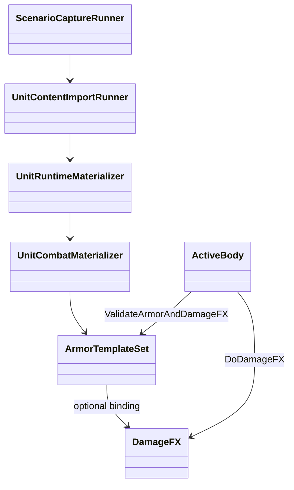
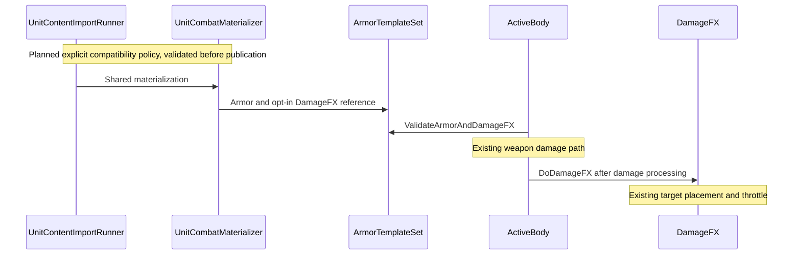

# X1: Imported-unit hit feedback

> Source of truth: [Track X](../track-x-fixes-tweaks.md).
> Audience: human + agent.

## Problem and scope

The mixed-source capture imports six EE2 reference rows but demonstrates one tank versus one Generals Rebel. Its tight crop cuts off the tank. Reports show health loss, but target-side feedback is absent on the imported tank.

Generals separates firing effects from damage effects. `GLARebelMachineGun` is effectively hitscan (`ProjectileObject = NONE`); adding a projectile is not the fix. The installed `TankDamageFX` maps small-arms damage to `FX_DamageTankStruckSmallArms`, with a throttle. `ActiveBody` obtains this binding from `ArmorTemplateSet.DamageFX`. Shared imported armor materialization currently supplies armor without this damage-effect binding.

EE2 ships impact visuals too, but importing its effect sequences is a separate capability. X1 uses an explicit, opt-in Generals presentation mapping, recorded as a compatibility choice, not as source-authored EE2 data. Only the imported vehicle selected by the capture receives the mapping. Imports without the policy retain their current behavior. Requested missing effects fail with actionable diagnostics before publication; silently selecting a global default is not acceptable.

## Design gate

`WI-X1-01` determines the narrow policy and lookup location. The implementation must preserve typed source records, scoped publication, and existing Generals bindings. The diagrams show existing runtime paths, not an already implemented import-policy extension. Reconcile the next card with the landed audit before marking it Ready.

Health bars and unit labels supplement, but do not replace, effects at the damaged target. Reuse existing capture/UI or overlay facilities first. Keep both complete model bounds and impact effects inside the frame throughout the duel. The output must be identified as a two-unit duel, not a full-roster or rearm demonstration.

## Architecture diagrams

## Evidence

The audit records source archive entry names, actual asset lookups, damage type selection, throttle, and the chosen policy representation. Final evidence includes the duel profile, command, damage assertions, and shared GIF. Headless health loss is not evidence of a rendered impact. No source assets are committed.
