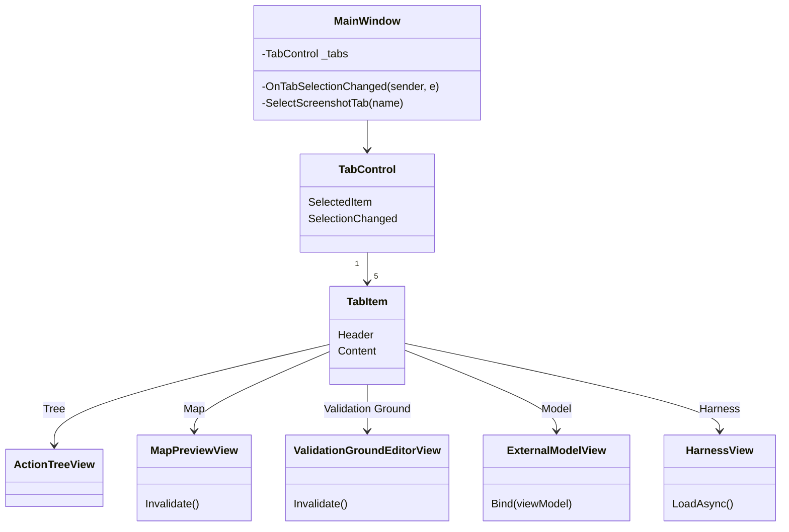
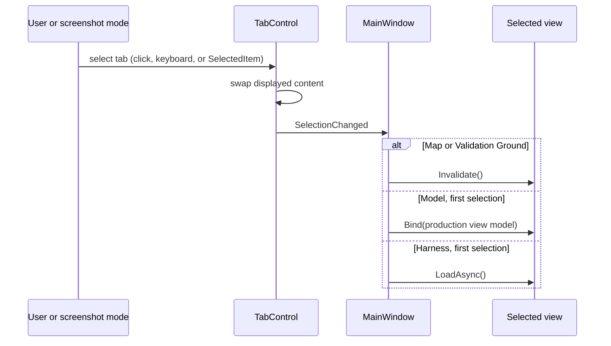

# X4: ReplaySketch TabControl shell

> Audience: human + agent.
> Phase and dependencies: [Track X](../track-x-fixes-tweaks.md). No dependencies; the Harness tab from P0-8 is already on `main`.

| Card | Status | Scope | Prerequisites |
|---|---|---|---|
| [WI-X4-01](../agent/cards/WI-X4-01-replaysketch-tabcontrol.md) | Ready | Replace the hand-built tab strip in `MainWindow` with an Avalonia `TabControl` | none |

## Starting point

- `src/Panopticon.Tools.ReplaySketch.Avalonia/MainWindow.cs` builds tabs by hand: five `Button` fields from `TabButton(...)`, five `Border` frames stacked in one `Grid`, and five `SwitchTo*` methods that toggle `IsVisible` and call `SetTabActive` for every button.
- Adding a tab means editing every `SwitchTo*` method. `SwitchToModel` already misses one: it neither hides `_harnessFrame` nor deactivates `_harnessTabBtn`, so selecting Model after Harness shows both frames stacked and two highlighted tabs.
- Side effects run on selection: Map and Validation Ground call `Invalidate()`; Model binds the production `ExternalModelViewModel` once, or the screenshot fixture; Harness calls `HarnessView.LoadAsync()` once.
- Screenshot mode selects a tab from `REPLAYSKETCH_SCREENSHOT_TAB` (`tree`, `map`, `validationground`, `model`, `harness`) before capture.
- `App` already adds `FluentTheme`, which styles `TabControl`.

## Risks

- `TabControl` shows only the selected `TabItem` content, so inactive views leave the visual tree. Views drawn through `Controls/SkiaCanvas` (map preview, action tree, validation ground) must render correctly after detach and reattach, and keep their state.
- Fluent's default tab header style differs from the current dark strip; headers stay readable on the `#1E1E1E` window background.

## Architecture diagrams

## WI-X4-01 results

Pending.
