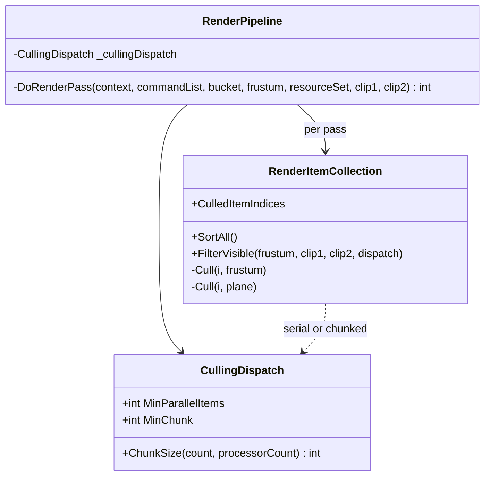
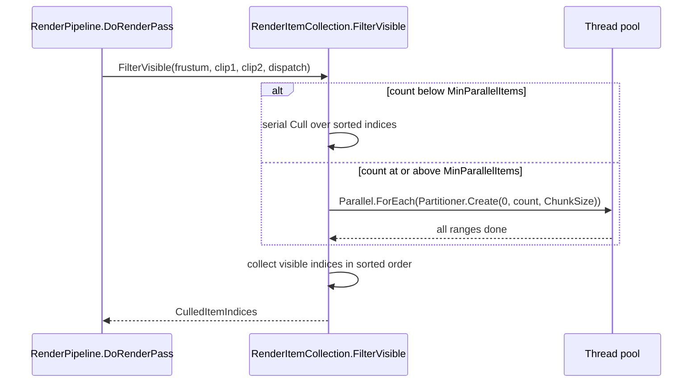

# X5: Render culling dispatch

> Audience: human + agent.
> Phase and dependencies: [Track X](../track-x-fixes-tweaks.md). Depends on M1 for the measurement scenario; builds on the B5 sort-once filter ([B5 deep dive](../deep-dives/b5-rendering-at-scale.md)).

| Card | Status | Scope | Prerequisites |
|---|---|---|---|
| [WI-X5-01](../agent/cards/WI-X5-01-culling-dispatch-sizing.md) | Ready | Measure per-pass culling cost and right-size `FilterVisible` dispatch | M1 |

## Starting point

- `RenderPipeline.DoRenderPass` calls `RenderItemCollection.FilterVisible(frustum, clip1, clip2, ParallelCullingBatchSize)` for every pass, with a fixed batch size of 128 (`RenderPipeline.cs:28`, `:538`, marked `TODO: Make culling batch size configurable at runtime`).
- Passes per frame: one per shadow cascade (default `ShadowMapCascades.OneCascade`), Opaque, Transparent, Water, plus the water reflection and refraction re-passes of Opaque when water maps render. Empty buckets return early.
- Any non-empty bucket goes through `Parallel.ForEach(Partitioner.Create(0, count, 128), ...)`, regardless of size. The loop body is one frustum-AABB test plus at most two plane tests per item, so a 128-item range is small relative to task dispatch. At the B5 10k measurement (61k visible items) one pass splits into about 480 ranges.
- The calling render thread blocks on each pass until all ranges finish.
- The probe renders only in windowed mode (`HarnessWindowedFrame.Step`); headless runs do not reach this path.
- `RenderItemCollectionSortFilterTests` covers the serial path (`batchSize: -1`) only.

## Operator capture (2026-10-20)

Windowed `MassBattleCapacityProbe`, Visual Studio task view. Times are per-activity averages.

| Activity | Count | Avg ms | Window ms |
|---|---|---|---|
| `Parallel.PartitionerForEachWorker` | 5340 | 0.07 | 26,718 to 222,597 |
| `TaskReplicator.Run` | 300 | 0.16 | 15,173 to 203,085 |
| Replica chain depth | up to 6 nested replicas | 0.02 to 0.32 | |

The capture shows the dispatch pattern: each run spawns a replica chain, and each replica finishes in tens of microseconds, which matches dispatch-dominated work. It is a task-activity view, not a CPU sample, so it does not establish the share of frame CPU spent in culling or spin-waiting. `WI-X5-01` records that share first.

## Design

- `CullingDispatch` (small record struct in `Graphics/Rendering`) replaces the `int batchSize` parameter. `CullingDispatch.Serial` keeps the existing test path.
- Serial below a threshold: `FilterVisible` takes the serial path when the sorted count is below `MinParallelItems`. The value comes from the card's measurement, not a guess.
- Processor-sized chunks above it: `ChunkSize` returns `max(count / processorCount, MinChunk)`, giving one range per worker instead of hundreds.
- Output is unchanged: the per-item result depends only on the item and the planes, and Step 2 already collects in sorted order, so serial and parallel lists are identical.
- Reusing the main-camera result for the water re-passes is out of scope: those passes use a different far plane and mirrored camera, so the frustum is not a superset.

## Risks

- On low-core hosts the threshold may disable parallel culling entirely. That is acceptable when the measurement shows serial is faster.
- The windowed probe frame time is dominated by logic and render-list construction (M1, B5). The culling gain may sit inside run-to-run noise; the card records that outcome rather than tuning numbers.

## Architecture diagrams

## WI-X5-01 results

Pending.
