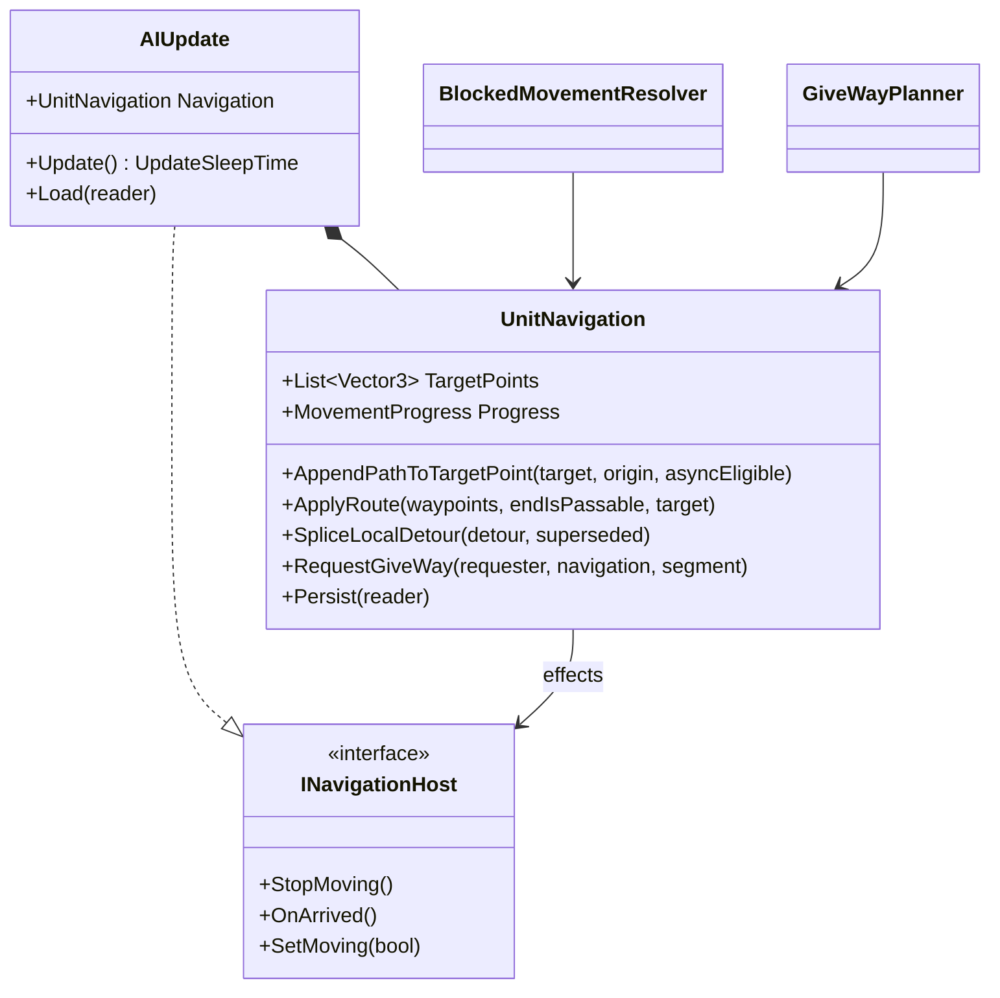

# X6: AIUpdate navigation extraction

> Audience: human + agent.
> Phase and dependencies: [Track X](../track-x-fixes-tweaks.md). Depends on the Track N stack (N6 to N11), which added most of the navigation code now inside `AIUpdate`. Background: [N deadlock deep dive](../deep-dives/n-navigation-deadlocks.md).

| Card | Status | Scope | Prerequisites |
|---|---|---|---|
| [WI-X6-01](../agent/cards/WI-X6-01-extract-ai-navigation.md) | Ready | Move path request, route application, blocked-movement, and give-way logic from `AIUpdate` into `UnitNavigation` with no behavior change | `WI-N11-01` |

## Starting point

- `AIUpdate.cs` is about 1350 lines and mixes order handling, state-machine glue, turret control, attack-move scanning, persistence, and navigation.
- Navigation members, found by name: `AddTargetPoint`, `AppendPathToTargetPoint`, `RequestPathAsync`, `OnPendingPathCompleted`, `ApplyRoute`, `SettleNoRoute`, `SettleGoalCrowded`, `TryCrowdArrive`, `SpliceLocalDetour`, `RequestGiveWay`, `SidestepWhileKeepingRoute`, `RecentlyGaveWay`, `AcceptSidestep`, `TryBeginLocalRepathAttempt`, `ResetLocalRepath`, `CheckPendingPathTimeout`, `CancelPendingPath`, `SetTargetPoint`, `MoveToNextWaypointOrStop`, plus the `TargetPoints` and `Progress` properties and the give-way, local-repath, and pending-path fields.
- Callers outside the class: `BlockedMovementResolver`, `GiveWayPlanner`, `GroupMovement`, `AIUpdateStateMachine` states, the `*AIUpdate` subclasses, and Navigation tests.
- Eleven subclasses derive from `AIUpdate`; the extraction must not change their virtual surface.

## Design

- `UnitNavigation` is one instance per `AIUpdate`, created in the constructor and exposed as `AIUpdate.Navigation`.
- It owns the route (`TargetPoints`), `MovementProgress`, the pending async path handle, and give-way and local-repath state.
- Effects that belong to `AIUpdate` (stop movement, arrival, model-condition flags) reach it through a narrow callback interface, so `UnitNavigation` never references `AIUpdate`.
- Persistence stays in `AIUpdate.Load`/`Persist`, which call `UnitNavigation.Persist` at the original field positions, keeping saves byte-compatible.
- `BlockedMovementResolver` and `GiveWayPlanner` take `UnitNavigation` instead of `AIUpdate` where they only touch navigation state.
- Moves are mechanical. Any semantic change found on the way is recorded as a follow-up, not made here.

## Risks

- Save compatibility: field order drift breaks old saves. Mitigated by an unchanged-save round-trip check.
- Determinism: a changed update order or evaluation order shows up in `SeededRunTests` and golden baselines. Such a failure is a suspected deviation, preserved and reported before any fix.
- Merge conflicts with in-flight Track N work: the card waits for the N stack to merge.
- Forwarders left behind: each is removed once its callers switch; leftovers are listed in the results.

## Architecture diagrams

## WI-X6-01 results

Pending.
