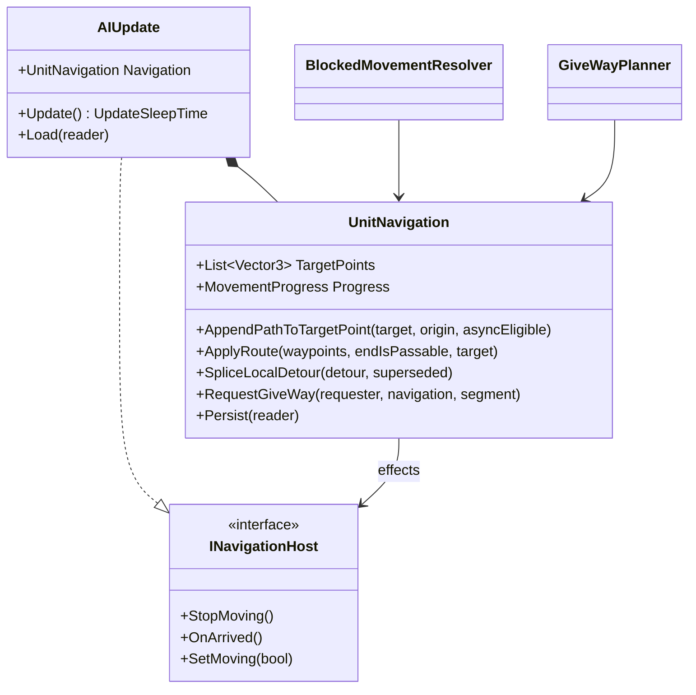

# X6: AIUpdate navigation extraction

> Audience: human + agent.
> Phase and dependencies: [Track X](../track-x-fixes-tweaks.md). Depends on the Track N stack (N6 to N11), which added most of the navigation code now inside `AIUpdate`. Background: [N deadlock deep dive](../deep-dives/n-navigation-deadlocks.md).

| Card | Status | Scope | Prerequisites |
|---|---|---|---|
| [WI-X6-01](../agent/cards/WI-X6-01-extract-ai-navigation.md) | Ready | Move path request, route application, blocked-movement, and give-way logic from `AIUpdate` into `UnitNavigation` with no behavior change | `WI-N11-01` |

## Starting point

- `AIUpdate.cs` is about 1350 lines and mixes order handling, state-machine glue, turret control, attack-move scanning, persistence, and navigation.
- Eleven subclasses derive from `AIUpdate`; the extraction must not change their virtual surface.

### Verified inventory (measured on this branch, 1353 lines)

| Member (AIUpdate) | Moves to UnitNavigation | External callers kept compiling via |
|---|---|---|
| `TargetPoints` property | yes (owner) | `AIUpdate.TargetPoints` forwarding property (37 files use it) |
| `Progress` property | yes (owner) | `AIUpdate.Progress` forwarding property (9 files) |
| `AddTargetPoint` | yes | forwarder (GroupMovement, DockUpdate, ProductionUpdate, subclasses) |
| `AppendPathToTargetPoint` | yes (takes `supportsAsyncOrderPaths` so the virtual stays on AIUpdate) | forwarder (HordeContain) |
| `RequestPathAsync`, `OnPendingPathCompleted`, `ApplyRoute` | yes | forwarder for `RequestPathAsync` (tests) |
| `SettleNoRoute`, `SettleGoalCrowded`, `TryCrowdArrive`, `SpliceLocalDetour` | yes | forwarders (GroupMovement, BlockedMovementResolver, tests) |
| `RequestGiveWay`, `SidestepWhileKeepingRoute`, `RecentlyGaveWay`, `AcceptSidestep`, `CurrentLogicFrame` | yes | forwarders (resolver, tests) |
| `TryBeginLocalRepathAttempt`, `ResetLocalRepath`, `CheckPendingPathTimeout`, `CancelPendingPath` | yes | forwarders (resolver, AIUpdate glue, tests) |
| `_pendingPathHandle`/`_pendingPathTarget`, give-way fields, local-repath fields | yes | none needed (private state) |
| `SetTargetPoint`, `MoveToNextWaypointOrStop` | no: order-handling glue (waypoint queue, horde routing, attack-move flags) | unchanged |
| `_moveOutOfWay1`/`_moveOutOfWay2` | yes (only persisted nav fields) | `UnitNavigation.Persist` called at the original position between `_repulsor2` and `_locomotorSet` |
| `BlockedMovementResolver.TryResolve(unit, aiUpdate, nav)` | signature takes `UnitNavigation` | AIUpdate move step passes `Navigation`; direct test call sites updated |
| `GiveWayPlanner.FindSidestep` | no signature change (already takes GameObjects + Navigation) | unchanged |

- Callers outside the class: `BlockedMovementResolver`, `GroupMovement`, `AIUpdateStateMachine` states, the `*AIUpdate` subclasses (Dozer, Jet, Missile, HackInternet, Supply, Worker), ScriptActions, OrderProcessor, TestHarness samplers, and Navigation tests.
- Not persisted today (stays unpersisted): `TargetPoints`, `Progress`, pending-path state, local-repath state, give-way cooldown fields. Only `_moveOutOfWay1/2` persist.
- Order of magnitude for the effect callback: moved code only needs `SetMoving(bool)` and `SetSpeed(float)` on the host; stop/arrival stay in AIUpdate glue.

## Design

- `UnitNavigation` is one instance per `AIUpdate`, created in the constructor and exposed as `AIUpdate.Navigation`.
- It owns the route (`TargetPoints`), `MovementProgress`, the pending async path handle, and give-way and local-repath state.
- Effects that belong to `AIUpdate` (stop movement, arrival, model-condition flags) reach it through a narrow callback interface, so `UnitNavigation` never references `AIUpdate`.
- Persistence stays in `AIUpdate.Load`/`Persist`, which call `UnitNavigation.Persist` at the original field positions, keeping saves byte-compatible.
- `BlockedMovementResolver` and `GiveWayPlanner` take `UnitNavigation` instead of `AIUpdate` where they only touch navigation state.
- Moves are mechanical. Any semantic change found on the way is recorded as a follow-up, not made here.

## Risks

- Save compatibility: field order drift breaks old saves. Mitigated by an unchanged-save round-trip check.
- Determinism: a changed update order or evaluation order shows up in `SeededRunTests` and golden baselines. Such a failure is a suspected deviation, preserved and reported before any fix.
- Merge conflicts with in-flight Track N work: the card waits for the N stack to merge.
- Forwarders left behind: each is removed once its callers switch; leftovers are listed in the results.

## Architecture diagrams

## WI-X6-01 results

Shipped 2026-10-28 on `track-x-x6-1-navigation-extraction`.

| Metric | Before | After |
| --- | --- | --- |
| AIUpdate.cs lines | 1353 | 1013 |
| UnitNavigation.cs | - | 494 |
| BlockedMovementResolver.cs | 216 | 215 |

Design as shipped:

- `UnitNavigation` (internal sealed, `Panopticon.Logic.Object`) owns the route (`TargetPoints`), `MovementProgress`, the pending async handle, and the give-way and local-repath state. One instance per `AIUpdate`, created in its constructor and exposed as the internal `AIUpdate.Navigation` property plus `HasPendingPath`.
- `AIUpdate` keeps order handling and state-machine glue. Public `TargetPoints`/`Progress` forwarding properties and one-line internal method forwarders (`AddTargetPoint`, `AppendPathToTargetPoint` passing `SupportsAsyncOrderPaths`, `RequestPathAsync`, `SettleNoRoute`, `TryCrowdArrive`, `RecentlyGaveWay`, `ResetLocalRepath`, `CheckPendingPathTimeout`, `CancelPendingPath`) keep the 37 external `TargetPoints` caller files and the subclasses compiling unchanged.
- `AIUpdate` implements `INavigationMovementSink` (`SetMoving(bool)` preserving the exact per-direction call shapes, `SetMoving` true via `SetModelConditionState` and false via `ModelConditionFlags.Set`; `SetSpeed(float)`). `UnitNavigation` holds no `AIUpdate` reference.
- `SetTargetPoint` and `MoveToNextWaypointOrStop` stayed in `AIUpdate`: they bridge the order waypoint queue and the virtual `ArrivedAtDestination`, which is order glue rather than navigation logic.
- Persistence: only `_moveOutOfWay1/2` were ever persisted; `Navigation.Persist(reader)` emits them at the original position between `_repulsor2` and the locomotor set, keeping saves byte-compatible.
- `BlockedMovementResolver.TryResolve(GameObject, UnitNavigation, Navigation)`: blocker give-way calls go through `blocker.AIUpdate.Navigation`; the WI-N11-01 approach-leg guard is preserved verbatim. `GiveWayPlanner` untouched.

Validation:

- Navigation filter `FullyQualifiedName~Panopticon.Tests.Navigation`: 97/97 passed.
- Full suite `Category!=Interactive`: ReplaySketch 512/512; Simulation 2566 passed / 10 failed / 8 skipped. Nine parked pre-existing failures diff-identical; `TerrainScorchDataTests.InstalledMaps_RecordScorchProducers` verified failing identically on the base commit 4645384af (environment drift, zero overlap).
- NavigationDeadlock before (base) / after / after2: every deterministic field identical (settled counts, termination, repath and reroute counts, request counts, stall-record identities and reasons, cycles, confirmations). The only varying fields (path spans, async-no-route stall-record timing, framesRun 92-93) differ between two runs of the same refactored build: async worker completion race, not behavior.
- `dotnet format src --verify-no-changes` and `scripts/check_brace_newline.py` clean.

Artifacts: `/tmp/x6-before.json`, `/tmp/x6-after.json`, `/tmp/x6-after2.json`, `/tmp/opencode/x6-01/`, logs `~/log/x6-01/`.
