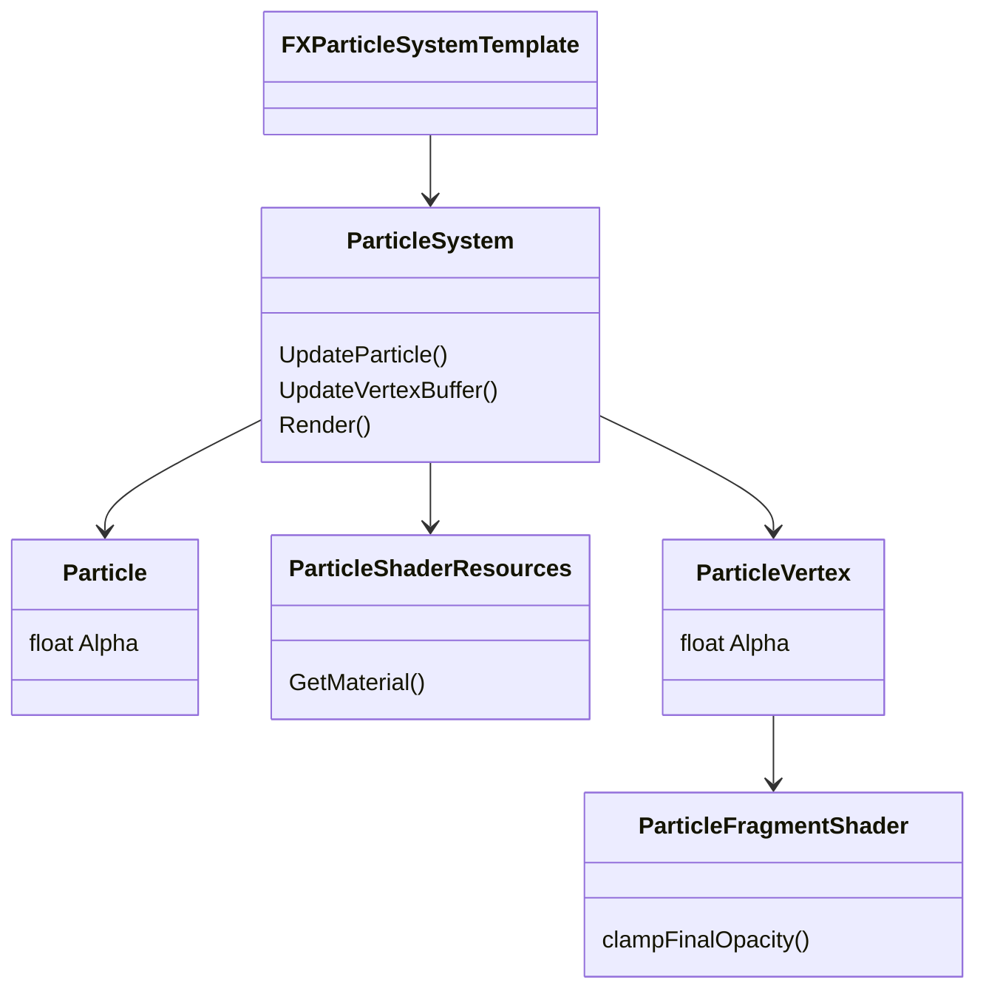
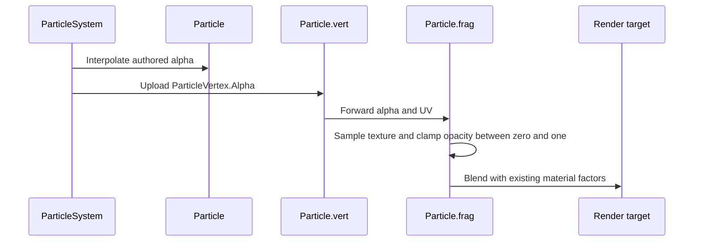

# macOS battle artifact follow-ups

> Corrective work for [G6](../track-g-rendering-clarity.md) and
> [P6](../track-p-playable-baseline.md), not new roadmap phases.
>
> Audience: human + agent.

## Evidence

Investigation date: 2026-10-14. Host: macOS, Metal, real C&C Generals assets.
The windowed `MassBattleCapacityProbe` uses Generals units only. The operator's
21:15:02 and 21:15:10 screenshots show tan smoke, black/green clouds, and both
silver and blackened Aurora models.

- `CarpetBombExplosionPuff` in `Data/INI/ParticleSystem.ini` interpolates from
  opacity `0.5` to a random value in `[-2, 0]`. `ParticleSystem.UpdateParticle`
  leaves opacity unclamped, and `Particle.frag` forwards it to blending.
- An isolated Aurora attack reproduced the clouds. Clamping opacity in a separate
  diagnostic Metal shader cache removed them. That experiment did not change
  source or the normal shader cache. Tan smoke at an early frame is not sufficient
  validation; captures must include the late negative-opacity interval.
- Jet smoke templates also contain negative opacity, including
  `JetExplosionSmoke`, `JetExplosionTrailSmoke`, and
  `JetExplosionTrailDebrisSmoke`. Their presence in game data is not proof that
  every attachment path currently executes. The fix belongs in the shared renderer.
- A Quad Cannon attacking an Aurora reproduced the transition to the blackened
  model after lethal damage. The authored `avaurora_d1.dds` wreck texture is dark;
  it is not a missing healthy-jet texture. The aircraft remained visible and moving
  after the capture manifest stopped listing it as a live actor.
- `JetSlowDeathBehaviorModuleData` inherits the factory that creates generic
  `SlowDeathBehavior`. No specialized jet runtime consumes its crash fields.
  Generic slow death does not implement ground-impact handling. Aurora's
  `DestructionDelay = 99999999` expects crash-driven removal, not that timer alone.

These are separate presentation and simulation defects. Other unexplained black
geometry in the capture map is outside this plan.

## Cards

| Card | Scope | Status | Depends on |
|---|---|---|---|
| [WI-G6-03](../agent/cards/WI-G6-03-clamp-particle-opacity.md) | Shared particle-opacity clamp and late-life capture regression | Ready | None |
| [WI-P6-06](../agent/cards/WI-P6-06-design-jet-crash-lifecycle.md) | Ground the jet crash lifecycle and implementation contract | Ready | None |
| [WI-P6-07](../agent/cards/WI-P6-07-implement-jet-crash-lifecycle.md) | Specialized jet death runtime and cleanup regression | Draft | WI-P6-06, WI-G6-03 |

The shipped G6/P6 milestones remain `Done`. These corrective follow-ups are
tracked separately in the [implementation checklist](../implementation-checklist.md)
and do not change the original phase progress totals.

## Reproduction contract

Use TestHarness `ScenarioCapture` with committed profiles added by the cards.
Map: `maps/alpine assault/alpine assault.map`. Hide HUD; settle five logic frames;
explicit camera looking at `(680, 640, 0)`.

| Profile | Actors and command | Duration and capture |
|---|---|---|
| `capture-aurora-opacity.json` | USA `AmericaJetAurora` at `(650, 640, 180)` attacks China `ChinaTankBattleMaster` at `(680, 640)` directly at frame 0 | 400 frames, stride 5, camera height 450 |
| `capture-aurora-crash.json` | GLA `GLAVehicleQuadCannon` at `(650, 640)` attacks USA `AmericaJetAurora` at `(680, 640, 110)` directly at frame 0 | 300 frames, stride 3, camera height 350 |

The first profile asserts `ProjectileObserved`; the second asserts
`ActorDestroyed`. The latter assertion alone does not prove physical removal:
the regression must also observe the dying object until its crash and final removal.
Retain captures across the full interval, not only the first explosion frame.
Artifact directories must be unique per run. Installation and screenshot-sharing
recipes: [screenshots.md](../../screenshots.md).

## Architecture diagrams

### Particle presentation boundary

Existing types and shader stages; the clamp is the proposed change.

### Jet lifecycle design gate

WI-P6-06 must supply grounded class and sequence diagrams here before WI-P6-07
becomes `Ready`. Required paths: airborne lethal damage, grounded lethal damage,
terrain impact, delayed final FX/OCL, and final object removal. Include ownership,
airfield reservations, physics integration, checkpoint state, and logical death
versus renderable-wreck lifetime. This section is not an executable design yet.
