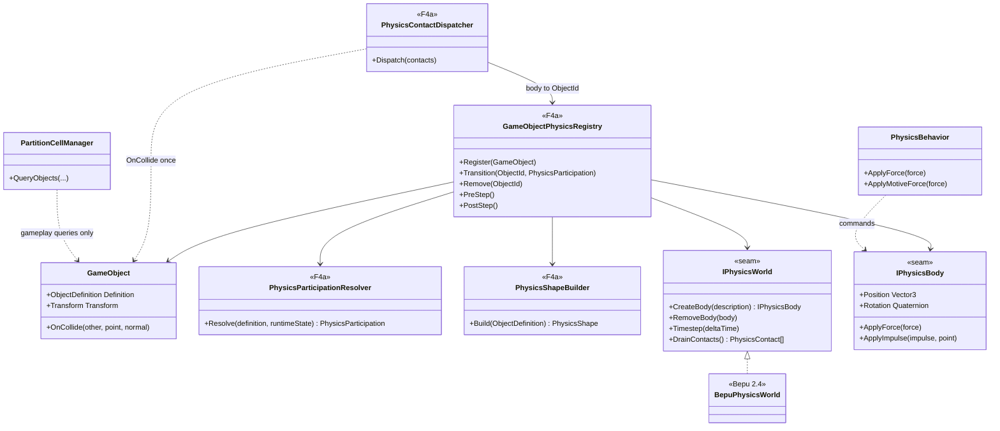
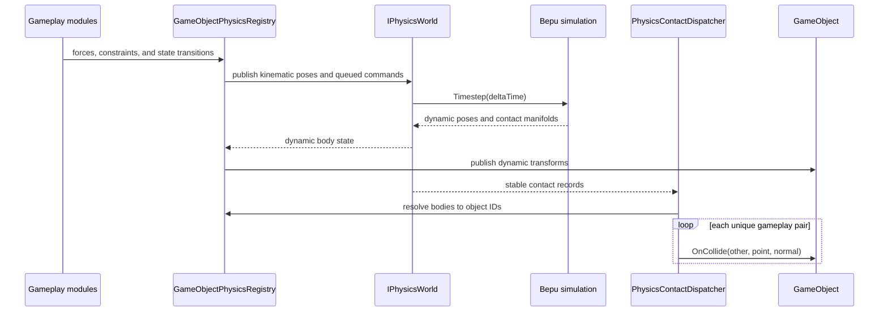

# Object Physics Adoption Plan

> Design authority for the object physics seam and the BepuPhysics2 integration. F4 and the
> F4a adoption phase reference this document for conventions, category coverage, and rationale.
> The executable specification lives in the WI-PS card steps once each slice starts.
>
> Used by
> [Track F: Object Physics, Deformable Terrain & Destruction](../track-f-terrain-destruction.md),
> phase F4 onward, and by every system that reads object dynamics or physical contacts.
>
> Audience: human + agent; object-physics design and migration authority.

---

## Purpose

Replace the hand-rolled per-object integrator and split collision ownership with one Bepu-backed
physics world behind an engine-internal seam. Every instantiated `GameObject` resolves through one
participation policy: dynamic, kinematic, static, sensor, or no physics. "All objects" means every
object is classified, not that visual effects, script markers, or other non-physical helpers receive
rigid bodies.

Two implementations sit behind the seam:

- Reference: the current `PhysicsBehavior` pipeline (translation-only Euler integration, hand-set
  rotation rates), extracted verbatim from
  `src/OpenSage.Game/Logic/Object/Behaviors/PhysicsBehavior.cs`. Proves the seam by reproducing
  today's behavior exactly.
- Bepu: `BepuPhysics` + `BepuUtilities` 2.4.0, gravity mapped from `GameData` `Gravity = -64`
  dist/sec².

The current proof of concept creates Bepu bodies only for objects with `PhysicsBehavior`, uses the
first INI geometry shape, selects one backend for a whole run, and has no Bepu-to-`OnCollide`
contact bridge. F4a closes those gaps before Bepu becomes the default.

---

## Decisions

| Decision | Value | Reason |
|---|---|---|
| Library | BepuPhysics2 (`BepuPhysics` + `BepuUtilities`) | Pure C#, Apache-2.0 (GPLv3-compatible), headless-capable, needed shapes present (box, sphere, cylinder, convex hull, mesh) |
| Version | Stable 2.4.0 | 2.5.0 is a long-running beta series |
| Incorporation | NuGet package references through central package management | Matches repo convention; no fork or submodule needed |
| Runtime target | Bepu is the default after F4a coverage; legacy remains an explicit comparison backend until removal is safe | Avoids making an incomplete proof-of-concept path the default |
| Backend scope | One backend per `GameEngine`, selected by injected configuration/factory | Keeps one coherent contact world while allowing parallel tests and B6 shards; replaces the proof-of-concept process-global policy |
| Participation | One resolver classifies every instantiated object by physical role and runtime state | `PhysicsBehavior` presence and `KindOf` flags alone do not cover structures, bridges, sensors, containment, or state transitions |
| Collision ownership | Bepu owns solid contact generation and response; `PartitionCellManager` retains gameplay queries and non-physical regions | Prevents two broad phases from resolving the same pair or emitting duplicate collision events |

---

## Architecture

Three layers keep Bepu out of gameplay code:

1. Seam (`OpenSage.Physics`): world, body, shape, material, filter, and contact interfaces. No Bepu
   types cross it.
2. Registration (`OpenSage.Game`): resolves participation, builds shapes, owns body lifecycle, and
   maps seam bodies back to `GameObject`s.
3. Gameplay adapters: `PhysicsBehavior`, locomotors, projectile updates, containment, death
   behaviors, and collision modules translate game semantics into forces, constraints, state
   transitions, and contact effects.

| Concern | Layer |
|---|---|
| Integration, gravity, contacts, torque, sleep | Seam backend |
| Motive-force window, lateral force filtering (`ApplyForce` / `ApplyMotiveForce`) | Adapter |
| `StickToGround`, `AllowToFall`, ground-collision relay | Adapter |
| Bounce restitution (`GroundStiffness`), fall-damage thresholds | Adapter |
| Crush levels, collision ignore lists | Adapter, mapped to backend collision filtering |
| `PitchRollYawFactor`, `CenterOfMassOffset` rotation steering | Legacy backend only; Bepu replaces it with angular dynamics or explicit orientation constraints |

Stepping: `IPhysicsWorld.Timestep` runs once per logic tick at the current physics position
(update Order1, after Order0 steering forces). The legacy backend steps per body from
`PhysicsBehavior.Update`; Bepu applies accumulated commands, steps all bodies once, drains contacts,
then publishes transforms and gameplay collision events.

Backend selection remains whole-world because one `GameEngine` owns one coherent contact world.
Selection moves from the mutable process-wide `PhysicsBackendPolicy` to per-engine configuration or
a factory so parallel tests and B6 shards cannot leak settings. Category migration is incremental
through participation and adapter coverage inside a Bepu run, not by mixing legacy and Bepu bodies
in the same scene.

### Participation policy

The resolver evaluates definition data plus runtime state. `KindOf` flags are inputs, not the policy
itself, because one object can change role during construction, containment, death, or deployment.
`Controlled` and `constrained` qualify dynamic participation; they describe the gameplay adapter or
constraint set, not additional backend motion types.

| Object role | Participation | Physics responsibility | Gameplay authority |
|---|---|---|---|
| Loose debris, hulks, crates, salvage, rocks, and thrown objects | Dynamic | Gravity, contacts, sleep, angular motion | Creation/death modules apply impulses and consume rest state |
| Infantry, cavalry, monsters, and horde members | Constrained dynamic | Ground and unit contacts; slope support | Pathfinding and locomotors choose routes and desired motion; upright constraints prevent incidental ragdolls |
| Ground vehicles, siege engines, and mobile builders | Dynamic | Hull contacts, slopes, pushing, mass, angular response | Locomotors apply drive/turn commands; pathfinding remains route authority |
| Aircraft, drones, parachuting units, and airborne deaths | Controlled dynamic, then unconstrained dynamic when falling | 3D contacts, gravity, toss/fall/bounce, landing impact | Flight locomotors control active flight; death/freefall state releases constraints |
| Ships, boats, and amphibious units | Constrained dynamic | Hull contacts and ramming; vertical support from water forces | E1 supplies water height/passability; F4a applies support; E2 owns ram damage |
| Ballistic projectiles, catapult rocks, and physical ordnance | Dynamic sensor or dynamic solid | Trajectory and first contact | Projectile behavior owns warhead delivery and lifetime |
| Guided, beam, or authored-arc projectiles | Kinematic sensor or no body | Swept contact only when a physical projectile exists | Guidance/arc code owns pose; hitscan and purely logical weapons stay outside the solver |
| Structures, defensive walls, bridges, immobile props, and terrain-attached obstacles | Static | Contact surface and obstruction | Construction, damage state, gates, and destruction own geometry/state changes |
| Gates, moving bridges, carrier decks, elevators, portable/deploying structures, and attached payloads | Kinematic | Contacts against game-authored motion | Owning behavior writes pose; dynamic objects receive contact response |
| Mines, traps, pickups, capture volumes, and proximity triggers | Static or kinematic sensor | Overlap detection without solver response | Existing modules decide activation, filtering, and effects |
| Contained passengers and attached subobjects | Suspended or kinematic with owner filtering | No independent response while contained; optional owner-relative contact after release | Container owns attach/detach and restores the classified mode on exit |
| `NO_COLLIDE`, drawable-only FX, waveguides, script markers, area helpers, and aggregate proxies with no physical volume | None | No body | Existing logic/query/render systems |

Every row is a default. Explicit engine-level overrides are allowed for exceptional definitions,
but no Bepu type or handle is stored in `ObjectDefinition`.

### Transform and lifecycle authority

- Dynamic: Bepu publishes position and rotation to `GameObject` after the world step.
- Kinematic: gameplay publishes the pose to Bepu before the world step.
- Static: placement or geometry-state changes rebuild or move the static collider; no per-frame
  transform sync.
- Sensor: transform authority follows its static or kinematic host, but contacts produce no
  impulses.
- Controlled dynamic: gameplay applies forces, target velocities, or constraints. It does not
  overwrite the post-step pose.

Registration occurs after final spawn/map placement. Removal occurs before object disposal.
Teleport, construction completion, geometry mutation, deploy/pack, contain/release, owner filtering,
death, and resurrection each have explicit body transitions. A transition preserves pose and
velocity where meaningful, removes stale contacts, and never leaves a body whose `GameObject` no
longer exists.

### Contacts and filters

Bepu contact callbacks identify seam bodies. The registration layer maps them to object IDs and
queues stable gameplay contact records for processing after the step. Solid pairs receive Bepu
response; sensor pairs only notify. Each pair emits at most one gameplay collision event per logic
frame, including compound-shape contacts.

The adapter preserves current rules for owner/container/cargo pairs, parachutes, explicit ignore
targets, `NO_COLLIDE`, projectile self-hits, crushability, and objects that need notification but
not physical response. Crush, ram, topple, fall damage, landing, and projectile impact consume
contact point, normal, relative velocity, and impulse from the same record.

`PartitionCellManager` remains authoritative for targeting, radius queries, shroud, pathing
occupancy, and logical regions. Its legacy solid-pair collision pass is retired for Bepu-managed
pairs once event parity is covered.

### Shape mapping

- Consume every `GeometryShape`, including offset, scale, rotation anchor, and additional geometry,
  rather than only the first shape.
- Cache immutable backend shapes by object definition and scale. Per-instance bodies reference the
  cache.
- Use sphere, box, and cylinder for authored INI geometry. Compound shapes represent multiple
  authored volumes.
- Use convex hulls or decomposed convex pieces for dynamic model-derived collision. Concave triangle
  meshes are static or kinematic only.
- Treat visual W3D meshes as collision input only when an explicit collision mesh is present or a
  reviewed fallback is generated. Rendering detail must not silently set gameplay collision.
- Rebuild or swap shapes when construction, damage, packing, upgrades, or runtime scale changes the
  physical footprint.

### Interface sketch

Target surface after F4a; the proof-of-concept interface is intentionally narrower.

```csharp
public enum PhysicsMotionType
{
    Static,
    Kinematic,
    Dynamic,
}

public interface IPhysicsWorld
{
    IPhysicsBody CreateBody(in PhysicsBodyDescription description);
    void RemoveBody(IPhysicsBody body);
    void SetTerrainChunk(int chunkX, int chunkY, ReadOnlySpan<TerrainPhysicsVertex> vertices, ReadOnlySpan<int> indices);
    void Timestep(float deltaTime);
    IReadOnlyList<PhysicsContact> DrainContacts();
}

public interface IPhysicsBody
{
    Vector3 Position { get; set; }
    Quaternion Rotation { get; set; }
    Vector3 LinearVelocity { get; set; }
    Vector3 AngularVelocity { get; set; }
    float Mass { get; set; }
    bool IsAwake { get; }
    bool IsGrounded { get; }
    void ApplyForce(Vector3 force);
    void ApplyImpulse(Vector3 impulse, Vector3 relativePosition);
}
```

`PhysicsBodyDescription` carries motion type, sensor flag, compound shape, mass properties,
material, initial transform, and collision filter. The game-side registry retains the
`IPhysicsBody` to `ObjectId` mapping so `OpenSage.Physics` does not depend on game types.

## Architecture diagrams

Planned F4a game-side types are marked `<<F4a>>`. Seam types and the Bepu backend exist in narrower
proof-of-concept form.

### Types



### Logic tick



### Terrain colliders

One Bepu static mesh per terrain chunk, chunk grid matching `TerrainPatch` and B4a's chunked
heightmap storage. Terrain registration moves from TestHarness-only setup into normal scene
lifecycle. `SetTerrainChunk` installs or replaces one chunk; deformation (F1/F2) rebuilds only
affected chunks. Adjacent chunks share boundary edge vertices so contacts do not glitch at seams.
Bridges, walls, carrier decks, and other object-owned surfaces remain object bodies rather than
being baked into terrain. Rebuild cost and broadphase overhead with a full-map chunk set are
benchmark scenarios.

### Bepu 2.4 implementation notes

Empirical constraints found while building the backend (verified against the 2.4.0 assembly):

- `Box` and `Cylinder` constructors take full extents, not half extents; `Sphere` takes a true
  radius. The seam's `PhysicsShape` uses half extents and converts.
- Mesh triangle winding is opposite the engine's terrain winding; `BepuPhysicsWorld.CreateMesh`
  swaps the last two indices of each triangle so normals point up (+Z).
- At engine world scale (10-unit terrain cells, gravity 64 dist/sec², falling speeds ~40/s), a
  speculative margin of 2.0 world units avoids tunneling; Bepu demo defaults (0.1) miss contacts.
- Sleep threshold 0.3 (velocity units/s) lets stacks island-sleep; lower values keep towers
  permanently awake at a 30 Hz timestep.
- Contact friction is a per-pair constant (0.3) in the narrow-phase callbacks and light angular
  damping (0.98/step) is applied in the pose integrator; without these, sliding objects tumble
  from friction torque. Per-body friction (mapping crush levels) needs a
  `CollidableProperty`-backed callbacks upgrade later.
- `PhysicsBodyDescription.IsStatic` and `PhysicsCollisionFilter` are not yet implemented uniformly:
  analytic shapes are created as dynamic bodies and callbacks currently allow every pair.
- Bepu contacts are not yet mapped back to `GameObject.OnCollide`; the legacy partition collision
  pass still supplies gameplay collision events.
- Bepu bodies are currently created by `PhysicsBehavior` only and are not removed through an
  object-lifecycle hook.

### Timestep and threading

The logic tick calls `Timestep(1 / LogicFramesPerSecond)`. The Bepu `Simulation` runs
single-threaded first; an `IThreadDispatcher` is added only if B1 benchmarks show need. Physics
commands are accumulated during module updates, the world steps once, contacts are published, and
dynamic transforms are synchronized before partition/pathing consumers observe the new state.

### Persistence and replay

- Cross-run divergence of Bepu outcomes is acceptable.
- Gameplay-decisive reads such as fall-damage kills, projectile impacts, crush/ram contacts, and
  push-apart displacement are validated by invariants and loose authored bounds.
- Persistence (F7): dynamic/kinematic motion type, transform, linear/angular velocity, sleep state,
  active constraints, and runtime participation transition. Static bodies are reconstructed from
  object definition and state. Bepu handles and broadphase internals are never serialized.

---

## Migration phases

| Phase | Scope | Exit criteria | Anchor |
|---|---|---|---|
| PS-0 | Seam carve-out: interfaces plus legacy backend extracted from `PhysicsBehavior` | Zero behavior change: P0 harness run and ReplaySketch screenshot output unchanged | Precedes F4; touches `OpenSage.Game` only |
| PS-1 | Bepu backend plus debris stack test scene, windowed and headless | Falling/stacking scene runs windowed and headless; ms per `Timestep` measured at 100/1k/10k bodies | F4 milestone |
| PS-2 | Per-engine world configuration, participation resolver, body lifecycle, compound shapes, filters, and contact-event bridge | Parallel engines select worlds independently; every instantiated definition resolves to a mode; lifecycle leaves no stale body; one filtered contact produces one gameplay event | F4a foundation |
| PS-3 | Loose dynamics: debris, hulks, crates, salvage, rocks, and thrown objects | Representative loose objects toss, collide, settle, sleep, wake, and clean up within authored bounds | F4a |
| PS-4 | Ground movers: infantry/cavalry/monsters, vehicles/builders, and siege | Representatives move, stop, turn, traverse slopes, push apart, and preserve pathfinding authority without tumbling or tunneling | F4a |
| PS-5 | Aircraft, drones, parachutes, carrier decks, and airborne death | Active flight remains controlled; freefall releases constraints; landing, bounce, fall damage, deck support, and cleanup use Bepu contacts | F4a |
| PS-6 | Static and kinematic world objects: structures, bridges, walls/gates, props, moving platforms, and deployables | Dynamic representatives contact each surface; state/geometry changes replace bodies without stale obstruction | F4a, prepares F5 |
| PS-7 | Projectile policy: ballistic, thrown, guided, authored-arc, and hitscan | Each weapon resolves to dynamic sensor, kinematic sensor, or no body; impact/warhead delivery occurs exactly once | F4a |
| PS-8 | Ships, boats, and amphibious units | Hull contacts, water support, contain/release, and shore transitions pass representative E1 scenarios; E2 consumes the contact bridge for ramming | F4a; prerequisite for E2 |
| PS-9 | Cross-game audit and default cutover | Installed definition catalogs for every supported `SageGame` have no unclassified instantiated objects; category matrix passes with Bepu as default and legacy as explicit comparison only | F4a milestone |

PS-0 is not gated on Track P, A1, or B1: no new runtime dependency, `OpenSage.Game` internal
refactor only. PS-1 follows F4's dependencies (headless host A1, benchmark harness B1). PS-2
through PS-9 form F4a and reuse P6b's archetype catalog plus P0/P9 scenario infrastructure. PS-8
uses E1's water data and supplies the contact path E2 uses for ramming.

---

## Project layout

```
src/OpenSage.Physics/
  OpenSage.Physics.csproj
  IPhysicsWorld.cs
  IPhysicsBody.cs
  PhysicsBodyDescription.cs
  PhysicsContact.cs
  PhysicsMaterial.cs
  TerrainPhysicsVertex.cs
  Bepu/BepuPhysicsWorld.cs
  Bepu/BepuPhysicsBody.cs
  Legacy/LegacyPhysicsBody.cs

src/OpenSage.Game/Logic/Physics/
  GameObjectPhysicsRegistry.cs
  PhysicsParticipationResolver.cs
  PhysicsShapeBuilder.cs
  PhysicsContactDispatcher.cs
```

Dependencies: `BepuPhysics`, `BepuUtilities` (2.4.0), `OpenSage.Mathematics`. Referenced by
`OpenSage.Game`, which owns the adapter and the backend policy.

---

## Validation

- Unit tests: participation decisions, compound shape conversion, filter pairs, transform
  authority, adapter semantics, gravity conversion, fall-damage thresholds, and material mapping.
- Lifecycle tests: create/remove/teleport, contain/release, construction, deploy/pack, death, and
  save/load keep registry/body counts and object mappings exact.
- Contact tests: solid response, sensor notification, ignored pair, compound pair deduplication,
  projectile impact, crush, ram, topple, landing, and carrier-deck support.
- P0/P9 harness: representative run-and-assert scenarios for every row in the participation table.
- Installed-data audit: enumerate instantiated object definitions for each supported `SageGame`,
  report the resolved mode and reason, and fail on an unclassified physical definition.
- ReplaySketch screenshot mode for visual verification of each phase.
- Benchmark (B1 harness): `Timestep`, contact dispatch, and transform sync at 100/1k/10k mixed
  bodies; terrain chunk rebuild; full-map static broadphase; sleep/wake and create/remove churn.
- Stability probe: repeated headless runs of the PS-1 scene assert loose settle bounds
  (settle height, displacement radius); cross-run divergence is acceptable and documented when
  large.

---

## Non-goals

- Replacing locomotor steering or pathfinding; they keep applying forces through the seam.
- Cross-run outcome guarantees.
- Full skeletal ragdolls, soft bodies, cloth, fluids, and destructible-body fracture inside Bepu.
- Replacing logical radius queries, targeting, shroud, or pathfinding occupancy with Bepu queries.
- Giving bodies to drawable-only, script-only, or aggregate helper objects with no physical role.
- Bepu 2.5.0-beta features.

---

## Task card index

Full cards are written when a phase's executable specification is needed; landed phases record
their exit evidence here instead.

| Card | Description | Status |
|---|---|---|
| `WI-PS-01` | Seam interfaces and legacy backend carve-out (PS-0) | Complete: `src/OpenSage.Physics` seam + `LegacyPhysicsBody`; physics tests pass; impulse capture regression remains unchanged |
| `WI-PS-02` | Bepu backend and test scene (PS-1) | Complete: `BepuPhysicsWorld` + `PhysicsStack` built-in scenario; loose settle bounds, stability probe, and ms/Timestep at 100/1k/10k bodies pass headlessly (windowed parity run pending, environment cannot present) |
| `WI-PS-03` | Benchmark scenarios | Partial: ms/Timestep measured in-scenario (0.03/0.1/3.1 ms at 100/1k/10k); B1-harness scenarios (chunk rebuild cost, full-map broadphase) not started |
| `WI-PS-04` | Participation resolver and cross-game definition audit (PS-2) | Not started |
| `WI-PS-05` | Per-engine world selection, body registry, lifecycle, compound shapes, filters, and contact bridge (PS-2) | Not started |
| `WI-PS-06` | Loose dynamic objects (PS-3) | Not started |
| `WI-PS-07` | Ground movers and push-apart (PS-4) | Not started |
| `WI-PS-08` | Aircraft, airborne transitions, and support surfaces (PS-5) | Not started; a minimal `UpdateBepu` adapter exists for whole-run selection |
| `WI-PS-09` | Static and kinematic world objects (PS-6) | Not started |
| `WI-PS-10` | Projectile participation modes and impact bridge (PS-7) | Not started |
| `WI-PS-11` | Ships and amphibious objects using E1 water data (PS-8) | Not started |
| `WI-PS-12` | Cross-game audit closure and Bepu default cutover (PS-9) | Not started |
| `WI-PS-13` | Persist all runtime physics state through F7 | Not started |
| `WI-PS-14` | Physics classification/contact/collider inspection through F8 | Not started |
