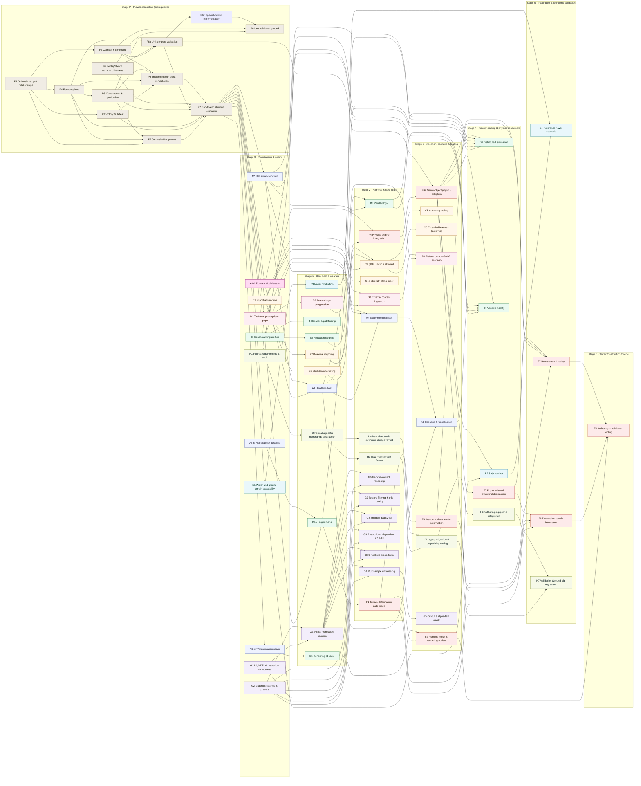

# Roadmap Tree

> Part of the [Large-Scale Simulation Roadmap](README.md). This document is the visual overview of
> the roadmap: tracks → phases → sub-phases, with dependency flow. Keep it aligned with the track
> documents ([A](track-a-foundations.md) · [B](track-b-scale.md) ·
> [C](track-c-external-assets.md) · [D](track-d-gameplay-expansion.md) ·
> [E](track-e-naval-warfare.md) · [F](track-f-terrain-destruction.md) ·
> [G](track-g-rendering-clarity.md) · [H](track-h-storage-formats.md)) and the deep dives as phases,
> sub-phases, or dependencies change; see [Tree maintenance](#tree-maintenance).
>
> Audience: human overview of roadmap structure and dependency flow.

The diagrams below cover two views:

- [1. Structure tree](#1-structure-tree): hierarchy only, every track, phase, and sub-phase.
- [2. Progression](#2-progression-dependency-flow): phase-level dependency flow, including
  cross-track edges.

Status is not encoded here. The authoritative status for each phase lives in its track document.

> For interactive zoom and pan, open [`roadmap-tree.html`](roadmap-tree.html) over HTTP, for
> example with `python3 -m http.server` from this folder; browsers block local `file://` fetches.
> It reads the diagrams live from this file. GitHub's rendered Mermaid diagrams also expose built-in
> zoom and pan controls.

---

## 1. Structure tree

Tracks → phases → sub-phases. Phases with a dedicated design document are marked ⮕.

```mermaid
mindmap
  root((OpenSAGE<br/>simulation<br/>roadmap))
    P. Playable Baseline
      P0 ReplaySketch command harness ⮕
        P0-1 Open command model
        P0-1a MAUI screenshot mode
        P0-1b ViewModel testability
        P0-1c MAUI command-flow testability
        P0-2 Generic definition resolution
        P0-3 Exporter generalization
        P0-4 Assertion layer
        P0-5 Run-and-assert entry point
        P0-6 Large/procedural authoring
        P0-7 Agent validation playbook
      P1 Skirmish setup and relationships ⮕
      P2 Skirmish AI opponent ⮕
      P3 Victory and defeat ⮕
        P3-1 GameOutcome scaffold
        P3-2 Defeat and win rules
        P3-3 Death-defeat event
        P3-4 End-of-match flow
        P3-5 Mutual elimination sudden death
        P3-6 Time-limit score decision
      P4 Economy loop ⮕
      P5 Construction and production ⮕
      P6 Combat and command ⮕
      P6b Unit-contract validation ⮕
        P6b-1 Infantry archetype
        P6b-2 Vehicle archetype
        P6b-3 Aircraft archetype
        P6b-4 Builder archetype
        P6b-5 Support archetype
        P6b-6 Superweapon archetype
      P6c Special-power implementation ⮕
        P6c-1 Cleanup area
        P6c-2 Object hack powers
        P6c-3 Hijacker hijack
        P6c-4 Validation-ground measurement
      P7 End-to-end skirmish validation ⮕
      P8 Implementation delta remediation ⮕
      P9 Unit validation ground ⮕
        P9-1 Primary-action model
        P9-2 Scenario and layout
        P9-3 Direct-spawn host
        P9-4 Action timer
        P9-5 TestHarness wiring
        P9-6 Report output
        P9-7 Baseline and regression gate
        P9-8 Test coverage
    A. Foundations
      A1 Headless host ⮕
        A1-1 Seam audit
        A1-2 Data-only asset loading
        A1-3 Logic-tick extraction
        A1-4 SimulationHost FTRT
        A1-5 Run outputs T0/T1/T2
      A2 Statistical validation
      A3 Sim/presentation seam
      A4 Experiment framework ⮕
        A4-1 Simulation Domain Model seam
        A4-2 AI decision policy seam
        A4-3 Decentralized hierarchical AI seam ⮕
      A5 Scenario and visualization ⮕
        A5-1 Scenario authoring
        A5-2 Experiment matrix
        A5-3 Results visualizer
        A5-4 Divergence localization
        A5-5 Authoring and visualization at scale
        A5-6 WorldBuilder baseline
    B. Scale
      B1 Profiling and benchmarking utilities
      B2 Allocation cleanup
      B3 Parallel data-oriented logic
      B4 Spatial and pathfinding
      B4a Larger maps ⮕
        B4a-1 Baseline audit
        B4a-2 Region editing
        B4a-3 Large-map wizard
        B4a-4 Terrain streaming and LOD
        B4a-5 Chunked storage
        B4a-6 Round-trip and play
        B4a-7 Large-population scenario authoring
      B5 Rendering at scale
      B6 Distributed simulation ⮕
        B6-1 Partition and boundary spec
        B6-2 Single-process multi-shard
        B6-3 Handoff and halo correctness
        B6-4 Cross-shard interactions
        B6-5 Cross-shard routing/flow
        B6-6 Multi-process transport
        B6-7 Load balancing
      B7 Variable fidelity ⮕
        B7-1 Fidelity model and policy
        B7-2 Temporal LOD
        B7-3 Simplified behavior
        B7-4 Group aggregation
        B7-5 Precision reduction
        B7-6 Fidelity visualization
    C. External models and animations
      C1 Import abstraction ⮕
      C2 Skeleton retargeting
      C3 Material mapping
      C4 First production format
      C4a EE2 NIF proof ⮕
      C5 Authoring tooling
      C6 Extended features deferred
    D. Gameplay content expansion
      D1 Tech tree prerequisite graph ⮕
      D2 Era and age progression ⮕
      D3 External content ingestion
      D4 Reference non-SAGE scenario
    E. Naval warfare
      E1 Water and ground terrain passability ⮕
      E2 Ship combat ⮕
      E3 Naval production
      E4 Reference naval scenario
    F. Object physics terrain and destruction
      F1 Deformation data model
      F2 Runtime mesh and rendering update
      F3 Weapon-driven terrain deformation
      F4 Physics engine integration ⮕
      F4a Game-object physics adoption ⮕
        PS-2 Participation lifecycle and contacts
        PS-3 Loose dynamics
        PS-4 Ground movers
        PS-5 Airborne objects
        PS-6 Static and kinematic objects
        PS-7 Projectile policy
        PS-8 Watercraft
        PS-9 Bepu default cutover
      F5 Physics-based structural destruction
      F6 Destruction-terrain interaction
      F7 Persistence and replay
      F8 Authoring and validation tooling
    G. Rendering clarity and image quality
      G1 High-DPI drawable and resolution correctness ⮕
        G1-1 Consumer classification audit
        G1-2 AllowHighDpi and drawable size
        G1-3 Render surfaces in pixels
        G1-4 2D and picking scale
      G2 Graphics settings and fidelity presets
      G3 Visual regression harness
      G4 Multisample antialiasing
      G5 Cutout and alpha-test clarity
      G6 Gamma-correct rendering
      G7 Texture filtering and mip quality
      G8 Shadow quality tier
      G9 Resolution-independent 2D and UI
      G10 Realistic proportions
    H. Map and unit storage formats
      H1 Format requirements and current-state audit
      H2 Format-agnostic interchange abstraction
      H3 New map storage format
      H4 New object and unit-definition storage format
      H5 Legacy migration and compatibility tooling
      H6 Authoring and pipeline integration
      H7 Validation and round-trip regression
```

---

## 2. Progression (dependency flow)

This left-to-right progression shows when phases become workable. Arrows mean "must precede."
Nodes keep their track colour (P = stone, A = blue, B = green, C = amber, D = pink, E = teal,
F = red, G = violet, H = olive). Track G is the one track not gated by Stage P: it changes
presentation only.
The [playable-baseline prerequisite (Stage P)](track-p-playable-baseline.md) gates the whole
roadmap. The [Simulation Domain Model seam (A4-1)](track-a-foundations.md) is its own highlighted
node because it is an early prerequisite of A1 even though the rest of A4 follows A1.

> Coordination, not ordering: A3 and C1 both touch the presentation seam, and B5 instancing
> should account for C4 (Track C) models. Those are coordination points, not strict dependencies,
> so they are omitted from the arrows above; see the [cross-track dependencies](README.md#cross-track-dependencies)
> note. D3 also depends on the standalone [ModCollector tool](plans/mod-collector.md), which is not
> part of a lettered track and has no engine dependency, so it is omitted as a node. H3 (new map
> storage format) coordinates with B4a-5 (chunked terrain storage) on the map-format terrain
> section; this is likewise a coordination point rather than a strict dependency, so no arrow
> connects them.

---

## Tree maintenance

Update this file in the same change that alters roadmap structure:

- Add, remove, or rename a phase or sub-phase → update the matching node in the
  [structure tree](#1-structure-tree), and in the [progression](#2-progression-dependency-flow)
  if it is a phase. Keep node text terse; detail lives in the track docs and deep dives.
- Add or remove a dependency → add or remove the matching arrow in the
  [progression](#2-progression-dependency-flow). Keep these arrows consistent with `todo_deps`
  and the deep-dive sequencing notes.
- A phase gains a deep dive → add the ⮕ marker to its node.
- Placing a node in a stage → put the phase just after its latest hard prerequisite
  (stage = longest dependency chain from Stage 0). If a new dependency moves it later, shift it
  right so arrows still flow left-to-right.
- Do not encode per-phase status here. Update the Status column in the track document instead.

This document is linked from the [README document map](README.md#document-map).
