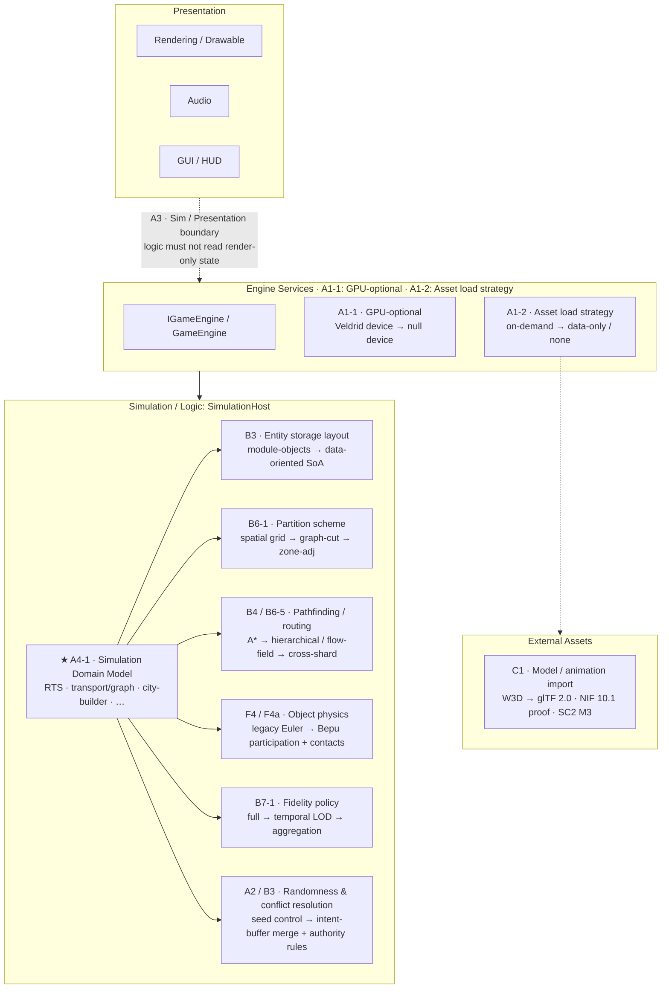

# Framework Seams

> Part of the [Large-Scale Simulation Roadmap](README.md). This document defines a seam and
> maintains the seam registry. It names each seam, states what it abstracts, and tracks the
> interface and implementations. Keep it aligned as seams are introduced or changed; see
> [Registry maintenance](#registry-maintenance).
>
> Audience: human and agent overview of the roadmap's pluggable seams.

## What is a seam?

A seam is a stable boundary around one axis of variation. It lets alternative
implementations be swapped behind the boundary and measured independently, without changing the
code that uses it.

The term follows Michael Feathers' sense of "a place where you can alter behaviour without
editing in that place," specialized here for a framework that plugs in and measures
simulation-optimization experiments. In this roadmap a seam has four properties:

1. One axis of variation. Each seam abstracts exactly one decision: the partition scheme, the
   simulation domain, or the entity data storage layout. It is not a grab-bag.
2. A stable interface. Callers depend on the interface, never on a concrete implementation.
3. Swappable, comparable implementations. Two or more implementations can sit behind it, and
   the [A4 experiment harness](track-a-foundations.md) can select one, run it against
   [B1 benchmarks](track-b-scale.md), and compare results.
4. A reference implementation. Usually the existing engine behaviour (e.g. RTS, W3D, the
   spatial grid) refactored to be one implementation, which proves the seam is real.

The roadmap uses two seam types:

- Structural seams: architectural boundaries that decouple subsystems so the simulation can
  run in new contexts such as headless or distributed execution. These are usually present or
  absent, not a menu of techniques.
- Experiment seams: the [A4](track-a-foundations.md) swappable-implementation axes. These are
  where optimization techniques plug in as interchangeable, independently measurable
  experiments. A Track B or C phase should usually land as an implementation behind an
  experiment seam rather than as a one-off hard-wired change.

> Rule of thumb: if a roadmap phase says "make X pluggable / swappable / domain-agnostic /
> behind an abstraction," it is introducing or widening a seam, add or update it here.

---

## Landscape overview

The diagram below places each seam in the runtime stack. Structural seams, shown with dashed
edges, are layer boundaries. Experiment seams are pluggable swap points inside the simulation
layer. The Simulation Domain Model is the central hub that parameterizes the others.

---

## Seam registry

Status legend: Reference = a working implementation exists, usually today's engine behavior.
Planned = introduced by a roadmap phase. Future = anticipated implementations behind the seam.
Code references point at the current types the seam is, or will be, carved from.

### Structural seams

| Seam | Axis of variation | Interface (current → planned) | Implementations | Introduced / owned by | Docs |
|---|---|---|---|---|---|
| Graphics / GPU-optional | Whether logic needs a real GPU device | `GraphicsDevice` (Veldrid) → null/abstraction device behind the same surface | Reference: real Veldrid device · Planned: null device (headless) | [A1-1](deep-dives/a1-headless-host.md) | [headless-host §3.1](deep-dives/a1-headless-host.md) |
| Engine services | Logic-side services available to gameplay vs. presentation | `IGameEngine` / `GameEngine` (`src/Panopticon.Simulation/GameEngine.cs`) | Reference: full engine · Planned: logic-only engine for the `SimulationHost` | [A1-4](deep-dives/a1-headless-host.md) | [headless-host §3](deep-dives/a1-headless-host.md) |
| Simulation / presentation | Boundary between logic state and presentation (`Drawable`/render/audio) | `IGameObjectClient` (`src/Panopticon.Simulation/Logic/Object/IGameObjectClient.cs`), implemented by `Drawable`; logic commands and asset-derived queries only, never render state | Reference: `Drawable` implementing the interface · Enforced: `LogicPresentationBoundaryTests` (empty allowlist) | [A3](track-a-foundations.md) | [track-a](track-a-foundations.md), [sim-presentation seam](deep-dives/a3-sim-presentation-seam.md) |
| Asset load strategy | Whether/when asset data is loaded vs. GPU-uploaded | `OnDemandAssetLoadStrategy` | Reference: on-demand + `None` · Planned: data-only logic load | [A1-2](deep-dives/a1-headless-host.md) | [headless-host](deep-dives/a1-headless-host.md) |

### Experiment seams (A4)

| Seam | Axis of variation | Interface (current → planned) | Implementations | Introduced / owned by | Docs |
|---|---|---|---|---|---|
| Simulation Domain Model | What the simulation is: entity/component schema, topology/space model, interaction model & locality, resolution authority, domain metrics, fidelity hooks | `ISimulationDomainModel` (`src/Panopticon.Simulation/Simulation/`), injected into `SimulationHost` (lifecycle, entity/metric projections, topology keys, interaction authority); optional `IDomainStateProjection` (planned, [A4-4](deep-dives/a4-4-domain-state-projection.md)) for versioned, reconstructable multi-field state with a schema-driven conservation check | Implementations: RTS reference adapter (`RtsSimulationDomainModel`, reproduces pre-seam recording exactly) · transport/graph validation adapter (`TransportGraphDomainModel`, tail-owner authority, edge metrics) · Planned: Western Front ([Track W](track-w-western-front.md), first A4-4 consumer) · Future: city-builder, agent-based ([Decision](open-questions.md)) | [A4-1](track-a-foundations.md), [A4-4](deep-dives/a4-4-domain-state-projection.md) | [domain-model](deep-dives/a4-simulation-domain-model.md), [track-a](track-a-foundations.md), [distributed-sim](deep-dives/b6-distributed-simulation.md) |
| Partition scheme | How the world is divided into shards/regions | `IPartitionScheme`-style abstraction (planned), built on `PartitionCellManager` / `Quadtree` (`src/Panopticon.Simulation/DataStructures/`) | Reference: spatial grid · Planned: graph-cut (transport) · Future: zone-adjacency (city) | [B6-1](deep-dives/b6-distributed-simulation.md) | [distributed-sim](deep-dives/b6-distributed-simulation.md) |
| Pathfinding / routing | How entities route across space/topology | Generalize `Navigation` A* (`src/Panopticon.Simulation/Navigation/`) | Reference: A* nav graph · Planned: hierarchical/flow-field; cross-shard routing; domain routing/flow | [B4](track-b-scale.md) / [B6-5](deep-dives/b6-distributed-simulation.md) | [track-b](track-b-scale.md), [distributed-sim](deep-dives/b6-distributed-simulation.md) |
| Entity storage layout | Memory/iteration layout of entity state | Behind the `GameObject`/module API (incremental data-oriented / SoA) | Reference: module objects · Planned: data-oriented hot-data storage | [B3](track-b-scale.md) | [track-b](track-b-scale.md), [open-questions (ECS lean)](open-questions.md) |
| Fidelity policy | How much detail an entity/region is simulated at (LOD) | Domain-supplied fidelity hooks + policy (planned) | Reference: full fidelity · Planned: temporal LOD, simplified behavior, aggregation, precision reduction | [B7-1](deep-dives/b7-variable-fidelity.md) | [variable-fidelity](deep-dives/b7-variable-fidelity.md) |
| Model / animation import | External asset format → engine interchange types | `IModelImporter` / `IAnimationImporter` behind `OnDemandAssetLoadStrategy` | Reference: W3D (refactored to one implementation) · Planned: glTF 2.0 (static + skinned) · Proof: NIF 10.1 (static) · Planned: StarCraft II M3 over `CascFileSystem` | [C1/C4a/C7](track-c-external-assets.md) | [track-c](track-c-external-assets.md) |
| Recording mode | How much run state persists and how granular frames are recovered | `RecordingOptions` + optional `IReconstructableDomain` (planned) on the domain model class | Reference: `Full` (A1-5 per-frame artifact) · Planned: `Operational` (operational stream, 6 h checkpoints, re-simulated granular frames) · Planned: Western Front adapter (`WI-W3a-31`) | [A1-6](deep-dives/a1-6-operational-recording.md) | [A1-6](deep-dives/a1-6-operational-recording.md) |
| Weapon hit resolution | Whether a fired shot hits its target | `IWeaponHitResolver` (planned), consulted in `Weapon.Fire` (`src/Panopticon.Simulation/Logic/Object/Weapon/Weapon.cs`) before `WeaponTarget.DoDamage` | Reference: null resolver, every direct shot hits (stock Generals) · Planned: `PeriodHitResolver`, seeded per-shot range table | [W3a](deep-dives/w3a-sedan-1870.md) | [W3a §7.1](deep-dives/w3a-sedan-1870.md#71-fire-resolution) |
| Map / object-definition format | On-disk serialization of map data and object/unit template data | `IMapFormat` / `IObjectTemplateFormat`-style abstraction (planned) behind `AssetStore` / `OnDemandAssetLoadStrategy` | Reference: legacy `.map` reader + INI `ObjectDefinition` parser (refactored to one implementation) · Planned: new versioned Panopticon format | [H2](track-h-storage-formats.md) | [track-h](track-h-storage-formats.md) |
| Randomness / conflict resolution | Source of randomness and how concurrent writes are reconciled | `IGame.CreateRandom()` seam + B3 intent/command buffers + merge/authority rules | Reference: selectable seed · Planned: persisted `SageRandom` logic random ([A1-6](deep-dives/a1-6-operational-recording.md)), intent-buffer merge + cross-shard authority rules | [A2](track-a-foundations.md) / [B3](track-b-scale.md) | [open-questions](open-questions.md), [distributed-sim](deep-dives/b6-distributed-simulation.md) |
| AI decision policy | How a player's strategic decisions get made (what to build/produce/attack), independent of actuation (always `Order`s) | `IAIDecisionPolicy` (`src/Panopticon.Simulation/Logic/AI/`), hosted by `AIPlayer.OnDecisionTick()`'s dispatcher; selection via `PlayerSetting.AIPolicy` resolved solely by `AIDecisionPolicyFactory` | Implementations: `RuleBasedAIDecisionPolicy` (reference, extracted from `SkirmishAIPlayer`), `NeuralNetworkAIDecisionPolicy` (inference-only, 125-float genome, [design](deep-dives/neural-network-ai-policy.md)); future: decentralized rank hierarchy (general/commander/soldier) of per-unit networks composed behind the same seam | A4 (design: [pluggable-ai](deep-dives/a4-pluggable-ai.md), [decentralized-hierarchical-ai](deep-dives/a4-decentralized-hierarchical-ai.md)) | [pluggable-ai](deep-dives/a4-pluggable-ai.md), [neural-network-ai-policy](deep-dives/neural-network-ai-policy.md), [skirmish-ai](deep-dives/p2-p5-skirmish-ai.md) |
| Object physics model | How each object participates in physical simulation and how contacts/dynamics are resolved | `IPhysicsWorld` / `IPhysicsBody` in `src/Panopticon.Physics/` plus the planned game-side participation registry and contact dispatcher; one backend injected per `GameEngine` and stepped once per logic tick | Reference: legacy `PhysicsBehavior` Euler backend · Available: BepuPhysics 2.4 proof of concept · Planned: Bepu default with complete cross-game object classification, lifecycle, filtering, and contact dispatch | [F4/F4a](track-f-terrain-destruction.md) | [track-f](track-f-terrain-destruction.md), [physics adoption plan](plans/physics-seam.md) |

> Derived, not separate: the [visualization](deep-dives/a5-visualization.md) layer's views and
> divergence-bucketing keys are parameterized by the Simulation Domain Model seam. The domain
> supplies the view and the stable bucket keys, so this is not an independent seam.

---

## Registry maintenance

- Adding a seam: when a phase introduces a new pluggable boundary, add a row to the correct
  table with its axis of variation, interface, implementations, and owning phase. Cross-link the
  phase doc back here.
- Widening a seam: when a new implementation is planned or lands, update the Implementations cell
  and adjust Reference, Planned, and Future as needed.
- Naming: name a seam by its axis of variation, not by its first implementation. For example,
  use "Partition scheme," not "Spatial grid."
- Keep it singular: if a row abstracts more than one axis, split it.
- This doc is linked from the [README document map](README.md#document-map); keep the
  [A4 notes](track-a-foundations.md) pointing here as the canonical seam list.
