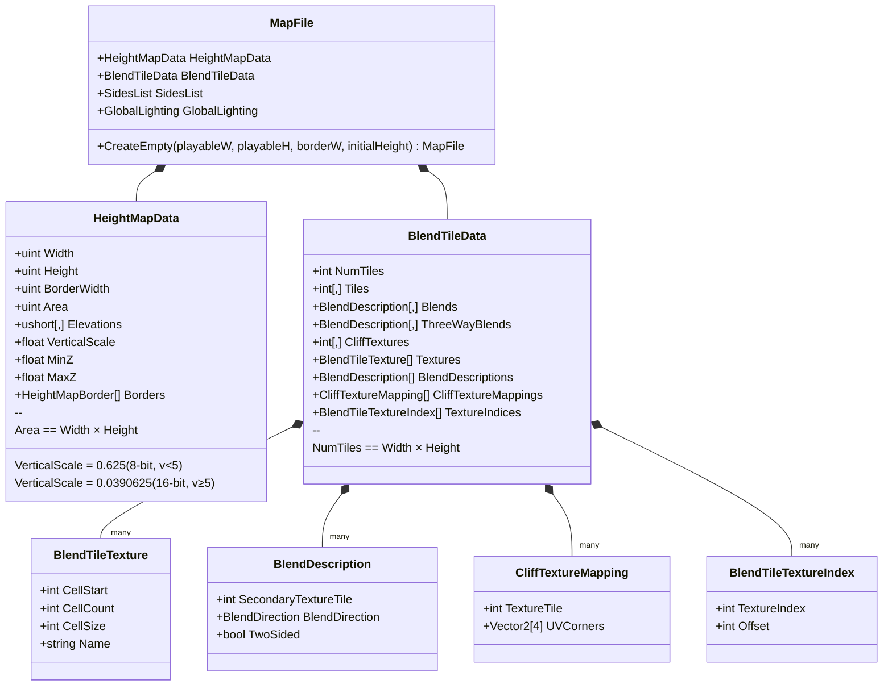
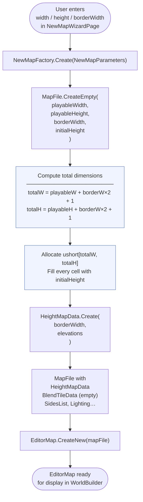
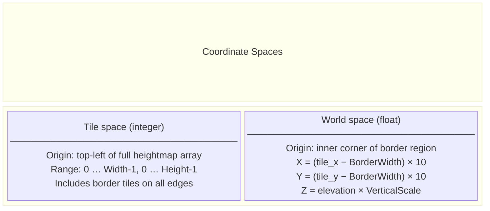
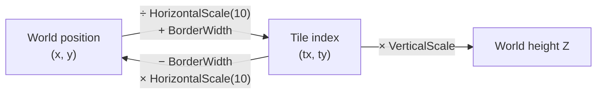
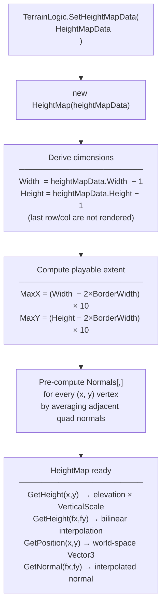
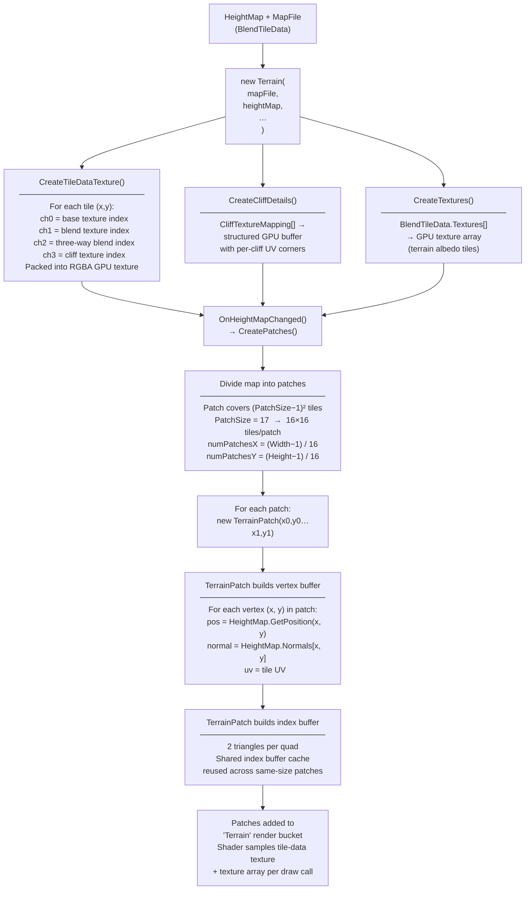
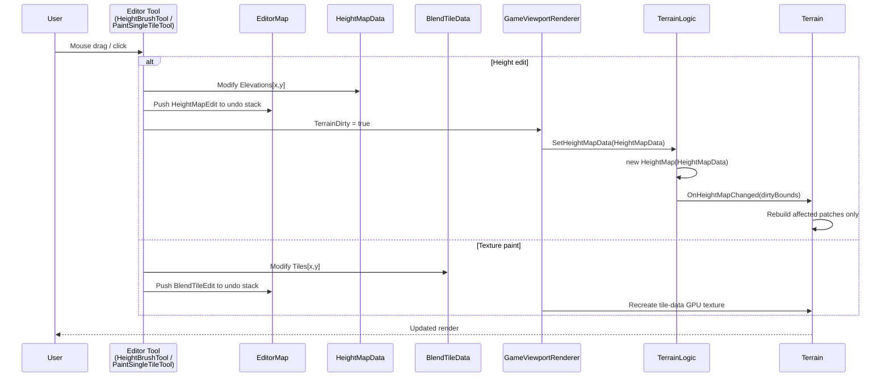

# WorldBuilder Terrain Diagrams

## 1. Data Structures

---

## 2. New Map Creation Pipeline

---

## 3. Coordinate System

---

## 4. HeightMap (Runtime) Construction

---

## 5. Terrain Mesh / Rendering Pipeline

---

## 6. Terrain Edit → Reload Loop (WorldBuilder)

